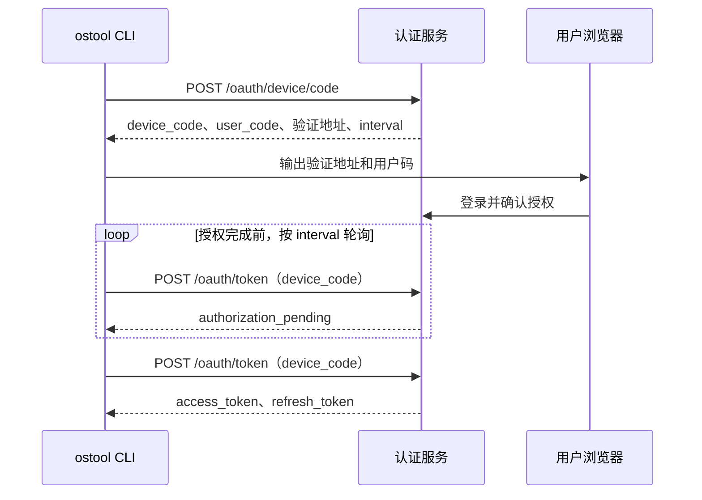

# `ostool` 后端服务 API

`ostool-server` 提供本地版和公网版，二者共用 PostgreSQL 和 Board REST / 串口 WebSocket 契约：

- 本地版使用 `auth_mode = "disabled"`，CLI 无需登录，网站隐藏账号和租赁功能。
- 公网版使用 `auth_mode = "required"`，CLI 通过同一服务器的 OAuth Device Authorization 登录，或使用个人访问令牌（PAT）；管理后台与前台有独立登录界面和浏览器 Cookie。

CLI 只调用 OAuth、Board REST 和串口 WebSocket；管理 API `/api/v1/admin/...` 要求后台管理员身份，CLI 凭据不能调用这些接口。

CLI 凭据的 `board:operate` scope 仅允许 Board REST、会话文件及串口操作；不允许读取或修改个人账号、创建令牌或管理登录设备。仅有 `offline_access` 的凭据不授予板卡操作权。登录页需要用户明确确认自己发起了设备登录并核对终端验证码。

### 公开设备目录和租赁授权

`GET /api/v1/site/devices` 在两种版本中均允许匿名访问，返回全部已配置设备（包括禁用设备），每项仅含 `id`、`board_type`、`tags`、`disabled`。网站 `/devices` 始终以卡片展示，通过公开的 `/api/v1/site/events` 订阅 `device_catalog` 更新；该流仅公开 `site` 和 `device_catalog`，不公开管理投影。禁用设备不可申请租赁。

公网版普通用户登录后申请租赁，管理员审批后与后台直接新增租赁一样写入 `board_rentals`。申请本身不占用设备。有效时段为 `[starts_at, ends_at)`；尚未开始、已到期或取消的租赁不授予使用权。CLI 的板型发现仅返回当前获分配设备，建立的会话通过 `session_owners.rental_id` 绑定正式租赁；心跳不能超出租赁结束时间。所有会话 API、串口升级、会话文件下载都校验当前身份和租赁归属；其他用户访问返回 404，无凭据返回 401。管理员账号有完整板卡访问权限。

取消、缩短租赁或到期会停止相关运行会话；撤销 OAuth 登录或 PAT 会关闭现有串口连接并释放设备（凭据复核最多间隔 5 秒）。OAuth 刷新属于同一登录族，不应中断正常串口连接；如果该登录族没有新的有效 access token，现有串口也会在 5 秒内关闭。

设备侧 TFTP 不支持用户 Bearer 鉴权；loader 与启动/共享文件允许配置的设备网段匿名访问，以兼容固件和板上下载命令。`http_url` 是设备可访问的文件地址，CLI 不会把用户 token 注入板上命令。公网 HTTP 下载则需要当前有效凭据和会话归属。独立吞吐测试监听器同样没有用户认证；部署时只向公网暴露 Caddy 的 HTTPS 入口，限制设备端口和设备网段，见 [安全配置](../ostool-server/README.md#security-configuration)。

服务地址来自全局或项目配置中的 `board.server`（完整 URL，可包含路径前缀），可被命令行 `--server` 覆盖；可选的 `board.port` 或 `--port` 用于覆盖 URL 中的端口。`auth_mode = "disabled"` 时该地址指向局域网 `ostool-server`；`auth_mode = "required"` 时该地址指向认证后端，OAuth 和受认证的 Board API 共用这个 Base URL。为兼容旧的局域网配置，`board.server` 为裸 IPv4 或 IPv6 地址时客户端自动补为 `http://`。基线版本写出的 `board.server_ip` / `board.port` 也会在读取时迁移为 `board.server` / `board.port`，下一次保存配置时只写新格式；无 scheme 的主机名不支持。

客户端会先把 Base URL 规范化为以 `/` 结尾，再将 HTTP 和 OAuth 接口路径追加到该路径。本文为简洁起见把接口写成 `/api/...` 或 `/oauth/...`；这些是相对于 Base URL 的接口标识，不表示实际请求必须位于域名根目录。例如 Base URL 为 `https://board.example.com/webapp/ostoolmanagephp/` 时，创建会话的实际 URL 是 `https://board.example.com/webapp/ostoolmanagephp/api/v1/sessions`。

- `auth_mode = "required"` 时，`board.server` 必须使用 HTTPS，Board REST 请求和串口 WebSocket 握手携带下文描述的 Bearer Token；OAuth Device Authorization、Token 和撤销请求不携带该 Header；
- `auth_mode = "disabled"`（默认）时通常使用 HTTP，不会发送认证 Header，适合局域网直连 `ostool-server`。

## 网络吞吐测试 API

`ostool-server` 另开专用 HTTP 监听地址，默认 `0.0.0.0:3000`，与默认使用 2999 端口的管理、开发板和会话文件接口分离。该监听器只安装本节路由，没有登录认证，部署时应限制在可信局域网内。它使用 HTTP 原始流测量上传和下载，不兼容 iperf2 协议；`ostool` CLI 的 `board.server` 不指向此端口。

### 测试生命周期

`POST /v1/tests` 创建一个随机 `test_id`，上传和下载各有独立结果，可以使用同一 ID 同时传输。每个方向只能启动一次；开始后不能用同一 ID 重试该方向。`GET /v1/tests/{id}` 返回两个方向的状态和计数。状态依次从 `not_started` 进入 `running`，随后成为 `completed`、`canceled`、`timed_out` 或 `failed` 之一；连接中断、传输错误和超时仍保留可查询的终态。

创建 ID 不占传输并发名额；首次启动上传或下载时才申请，默认最多允许 64 个 ID 同时传输，同一 ID 的双向流只占一个名额。第 65 个并发传输请求立即返回 `429`，该方向仍保持 `not_started`，可以稍后重试。默认传输时限为 3600 秒；未开始的记录 10 分钟过期，最后一个运行方向结束后记录保留 1 小时。内存中最多保留 4096 条记录，满额时优先清除最旧的结束记录。记录不写入磁盘，服务器重启后不再可查询。该独立监听器的内置参数如下；部署默认关闭，使用 `.env` 的 `OSTOOL_NETWORK_TEST_ENABLED`、`OSTOOL_NETWORK_TEST_LISTEN_ADDR`、`OSTOOL_NETWORK_TEST_MAX_ACTIVE` 和 `OSTOOL_NETWORK_TEST_MAX_DURATION_SECS` 显式启用与调整：

```toml
[network_test]
enabled = true
listen_addr = "0.0.0.0:3000"
max_active_tests = 64
max_duration_secs = 3600
```

这些设置由 `ServerConfig.network_test` 读取。`listen_addr` 不能与管理监听器使用同一端口，`max_active_tests` 和 `max_duration_secs` 必须大于 0。`enabled = false` 关闭专用监听器；配置修改需重启服务才会改变监听地址和容量。

### 请求与响应

上传请求体按网络到达的块计数并丢弃，不落盘或整体缓存在内存中。下载响应为 `application/octet-stream`，`bytes=N` 生成指定字节数，`duration_secs=N` 持续到指定时长，两种参数只可选择其一且 `N` 必须为正数；指定时长必须在配置的传输时限内，下载流受 TCP 背压控制。两方向均不设置固定的总字节数上限，计数采用 `u64`。按时长下载时，最终实际字节数需要在传输结束后查询结果。

| 方法与路径 | 成功响应 | 用途 |
| --- | --- | --- |
| `GET /healthz` | `200 OK` | 检查专用监听器是否响应 |
| `POST /v1/tests` | `201 Created`，`{"test_id":"..."}` | 创建测试 ID |
| `PUT /v1/tests/{id}/upload` | `200 OK`，方向结果 JSON | 上传原始请求体，结束后返回计数与吞吐率 |
| `GET /v1/tests/{id}/download?bytes=N` | `200 OK`，原始字节流 | 下载指定字节数 |
| `GET /v1/tests/{id}/download?duration_secs=N` | `200 OK`，原始字节流 | 在指定时长内持续下载 |
| `GET /v1/tests/{id}` | `200 OK`，测试结果 JSON | 查询上传和下载状态 |

结果包含 `test_id` 以及 `upload`、`download` 两个方向对象。每个方向的 `status`、`bytes`、`elapsed_ms`、`bits_per_second` 和 `error` 分别表示状态、服务端处理的字节数、耗时、平均吞吐率及错误；未开始时耗时和吞吐率为 `null`，无错误时 `error` 为 `null`。下载方向的服务端字节数表示已生成的响应体字节；连接中断时客户端实际收到的字节数可能更少，应以客户端收到的数据量核对。上传的 `200 OK` 结果使用同一方向对象格式。

| HTTP 状态 | 原因 |
| --- | --- |
| `400 Bad Request` | 查询参数缺失、冲突或取值无效 |
| `408 Request Timeout` | 上传达到最长运行时限；服务端保留 `timed_out` 结果 |
| `404 Not Found` | 测试 ID 不存在或记录已过期 |
| `409 Conflict` | 同一测试 ID 的同一方向已启动 |
| `429 Too Many Requests` | 启动传输时并发名额已满，或创建 ID 时记录容量已满且没有可淘汰的结束记录 |

上传超时时，连接仍在时返回带 `timed_out` 错误码的 `408` JSON。指定字节数的下载若达到最长运行时限，则已开始的响应体中断，不能再返回新的 HTTP 状态码；使用 `GET /v1/tests/{id}` 可查询 `timed_out` 终态。按时长下载到期属于正常完成。客户端主动断开时也可能收不到错误体，应查询记录。普通开发板会话文件的 `PUT /api/v1/sessions/{session_id}/files` 仍在管理监听器上，继续受它自身的上传大小限制。

### 使用 curl 测试

先创建测试 ID，再把响应中的 UUID 填入 `test_id`。以下命令分别上传和下载 1 GiB，下载文件在客户端丢弃；上传结果直接打印，随后查询双向结果：

```bash
base=http://10.3.10.194:3000
curl -fsS -X POST "$base/v1/tests"
test_id='UUID_FROM_POST_RESPONSE'
dd if=/dev/zero bs=1M count=1024 status=none | curl -fsS -T - "$base/v1/tests/$test_id/upload"
curl -fsS "$base/v1/tests/$test_id/download?bytes=1073741824" -o /dev/null
curl -fsS "$base/v1/tests/$test_id"
```

全双工测试在同一 ID 下并发启动两个请求，各方向各有自己的计数和终态。先创建新 ID 并替换占位符；下面的下载以 30 秒为目标时长，`wait` 可分别检查两个 `curl` 进程的退出状态：

```bash
curl -fsS -X POST "$base/v1/tests"
test_id='UUID_FROM_NEW_POST_RESPONSE'
dd if=/dev/zero bs=1M count=1024 status=none | curl -fsS -T - "$base/v1/tests/$test_id/upload" &
upload_pid=$!
curl -fsS "$base/v1/tests/$test_id/download?duration_secs=30" -o /dev/null &
download_pid=$!
wait "$upload_pid"
wait "$download_pid"
curl -fsS "$base/v1/tests/$test_id"
```

每个方向只能启动一次，第二次示例因此必须使用新 ID。原始流接口无需专用客户端，标准 `curl` 即可发起和查询；这不改变已有 iperf2 服务或板卡测试。

## 通用认证规则

当 `auth_mode = "required"` 时，所有下列 board HTTP 请求和串口 WebSocket 握手均携带：

```http
Authorization: Bearer <access_token>
```

Access Token 选择规则：

1. `OSTOOL_BOARD_ACCESS_TOKEN` 非空时优先使用；该值不保存也不刷新；
2. 否则读取当前 endpoint 保存的一条本地凭据：PAT 直接使用，OAuth Access Token 剩余有效期超过 60 秒时直接使用；
3. OAuth Access Token 剩余有效期不超过 60 秒时，使用保存的 Refresh Token 刷新后再发送请求。

HTTP 客户端不跟随重定向。认证模式下，绝对 WebSocket URL 必须使用 Base URL 对应的 WebSocket scheme（HTTP 对应 `ws`，HTTPS 对应 `wss`），并与 Base URL 使用相同的 host 和有效端口。

## 命令索引

表中未写全的会话路径均以 `/api/v1/sessions/{session_id}` 为前缀。

| 命令 | 基本功能 | `auth_mode = "required"` 时的行为 | 涉及 API |
| --- | --- | --- | --- |
| `ostool login [--server URL] [--port PORT]` | 发起浏览器 Device Authorization 登录。 | 保存 OAuth 凭据；未指定 `--server` 时使用全局 board 配置。 | `POST /oauth/device/code`；`POST /oauth/token`（Device Code 轮询） |
| `ostool login --with-token [--server URL] [--port PORT]` | 从标准输入导入 PAT。 | 保存 PAT；不刷新该 Token。 | 无网络 API |
| `ostool auth status [--server URL] [--port PORT]` | 显示当前 endpoint 的认证状态。 | 显示凭据类型、已知过期时间和 scope，不显示 Token。 | 无网络 API |
| `ostool logout [--server URL] [--port PORT]` | 退出登录。 | OAuth 凭据会尝试远端撤销；随后删除本地凭据。PAT 仅删除本地副本。 | `POST /oauth/revoke`（仅 OAuth） |
| `ostool board ls [--server URL] [--port PORT]` | 查询按类型聚合的可用开发板信息。 | 调用时携带 Bearer Token。 | `GET /api/v1/board-types` |
| `ostool board connect --board-type TYPE [--board-id BOARD_ID] [--server URL] [--port PORT]` | 请求服务端从指定类型中自动分配一块开发板，或指定一块开发板，并打开串口终端。 | REST 和 WebSocket 请求均携带 Bearer Token。 | `POST /api/v1/sessions`；`POST /api/v1/sessions/{session_id}/heartbeat`；WebSocket `/api/v1/sessions/{session_id}/serial/ws`；`DELETE /api/v1/sessions/{session_id}` |
| `ostool board run [--server URL] [--port PORT]` | 构建后请求服务端按 `.board.toml` 的 `board_type` 自动分配开发板并启动。 | REST 和 WebSocket 请求均携带 Bearer Token。 | 始终：`POST /api/v1/sessions`、`POST /api/v1/sessions/{session_id}/heartbeat`、`DELETE /api/v1/sessions/{session_id}`。U-Boot：`GET /boot-profile`、`GET /serial`、`GET /tftp`、`GET /dtb`、`GET /dtb/download`、`PUT /files`、WebSocket `/serial/ws`。HTTP Boot：`GET /boot-profile`、`GET /serial`、可选 `PUT /http-boot/files`、`PUT /http-boot/kernel`、WebSocket `/serial/ws`。 |

## OAuth Device Authorization API

本节接口由公网版 `ostool-server` 提供，本地版返回 404。所有 OAuth 请求使用 `application/x-www-form-urlencoded`；CLI 的请求格式与既有设备授权协议一致。

### 基本原理

该流程是 OAuth 2.0 Device Authorization Grant，适用于 CLI、SSH 和无图形界面环境。它将浏览器中的用户登录与 CLI 获取 Token 分离，使 `ostool` 不接触用户密码，也不需要接收浏览器回调。



第一步只创建短期授权请求：`device_code` 供 CLI 轮询使用，不应展示给用户；`user_code` 用于浏览器授权。用户完成登录和授权前，`/oauth/token` 返回 `authorization_pending`，客户端按服务端给出的轮询间隔继续等待。登录成功后，后续续期仅使用 Refresh Token 调用 `/oauth/token`，不再重新执行设备授权流程。

### 获取设备登录码

```http
POST /oauth/device/code
Content-Type: application/x-www-form-urlencoded

client_id=ostool-cli&scope=board%3Aoperate+offline_access
```

响应至少应包含：

```json
{
  "device_code": "opaque-device-code",
  "user_code": "ABCD-EFGH",
  "verification_uri": "https://board.example.com/activate",
  "verification_uri_complete": "https://board.example.com/activate?user_code=ABCD-EFGH",
  "expires_in": 600,
  "interval": 5
}
```

`verification_uri_complete` 可选；未返回 `interval` 时，客户端默认每 5 秒轮询。

### 使用设备登录码换取 Token

```http
POST /oauth/token
Content-Type: application/x-www-form-urlencoded

grant_type=urn:ietf:params:oauth:grant-type:device_code
&device_code=<device_code>
&client_id=ostool-cli
```

客户端在 `expires_in` 期间按 `interval` 轮询。`authorization_pending` 必须作为非 2xx OAuth 错误响应返回，客户端会继续轮询；`slow_down` 同样必须作为非 2xx OAuth 错误响应返回，客户端会将轮询间隔增加 5 秒。成功的 2xx 响应必须包含下文的完整 Token 字段。

### 刷新 Access Token

```http
POST /oauth/token
Content-Type: application/x-www-form-urlencoded

grant_type=refresh_token
&refresh_token=<refresh_token>
&client_id=ostool-cli
```

当 OAuth Access Token 剩余有效期不超过 60 秒时调用。多个进程共享 Refresh Token 时，客户端会先获得本地跨进程锁，避免并发刷新。

### Token 响应

上述两个 `/oauth/token` 请求均要求返回：

```json
{
  "access_token": "...",
  "refresh_token": "...",
  "token_type": "Bearer",
  "expires_in": 900
}
```

`token_type` 必须为 `Bearer`，`expires_in` 必须为正数，`refresh_token` 必须非空。`scope` 为可选字段。服务端应在刷新时返回轮换后的 Refresh Token。

### 撤销 OAuth 会话

```http
POST /oauth/revoke
Content-Type: application/x-www-form-urlencoded

token=<refresh_token>
&token_type_hint=refresh_token
&client_id=ostool-cli
```

执行 `ostool logout` 时调用。客户端将 HTTP 2xx 和 404 都视为成功；其他错误只会输出警告，随后仍删除本地凭据。

### OAuth 错误响应

认证客户端尝试解析：

```json
{
  "error": "invalid_grant",
  "error_description": "optional detail"
}
```

刷新时若错误包含 `invalid_grant` 或 `invalid_token`，客户端删除本地 OAuth 凭据并要求重新登录。

## Management API

`ostool-server` 的管理页面位于 `/admin`，页面使用同源的 `/api/v1/admin/...` 接口维护开发板、DTB、活动会话、TFTP 和服务器可编辑配置。除 DTB 上传使用原始字节外，请求和响应均使用 JSON。

公网版管理 API 安装了管理员身份、后台登录来源、CSRF 来源和敏感操作身份复核中间件；管理页面使用独立的 `/admin/login`。网站 Cookie、普通成员、CLI OAuth 和 PAT 不能代替后台管理员登录。本地版保持免登录，仅适合可信内网。部署时由 Caddy 提供 HTTPS，并限制 Rust 原始监听端口和设备端口的访问范围。

### 接口索引

| 功能 | 方法与路径 |
| --- | --- |
| 管理概览 | `GET /api/v1/admin/overview` |
| 开发板列表与创建 | `GET /api/v1/admin/boards`；`POST /api/v1/admin/boards` |
| 单块开发板 | `GET /api/v1/admin/boards/{board_id}`；`PUT /api/v1/admin/boards/{board_id}`；`DELETE /api/v1/admin/boards/{board_id}` |
| 开发板电源状态 | `GET /api/v1/admin/boards/{board_id}/power-status` |
| 开发板租约状态 | `GET /api/v1/admin/boards/{board_id}/runtime-status` |
| 串口与网卡发现 | `GET /api/v1/admin/serial-ports`；`GET /api/v1/admin/network-interfaces` |
| axloader 设备发现 | `GET /api/v1/admin/loader-devices` |
| QEMU 虚拟设备 | `GET /api/v1/admin/virtual-devices`；`POST /api/v1/admin/virtual-devices`；`DELETE /api/v1/admin/virtual-devices/{device_id}` |
| DTB 列表与创建 | `GET /api/v1/admin/dtbs`；`POST /api/v1/admin/dtbs` |
| 单个 DTB | `GET /api/v1/admin/dtbs/{dtb_name}`；`PUT /api/v1/admin/dtbs/{dtb_name}`；`DELETE /api/v1/admin/dtbs/{dtb_name}` |
| 租约历史 | `GET /api/v1/admin/session-history` |
| 活动会话 | `GET /api/v1/admin/sessions`；`DELETE /api/v1/admin/sessions/{session_id}` |
| TFTP 配置 | `GET /api/v1/admin/tftp`；`PUT /api/v1/admin/tftp` |
| TFTP 状态与协调 | `GET /api/v1/admin/tftp/status`；`POST /api/v1/admin/tftp/reconcile` |
| 服务器配置 | `GET /api/v1/admin/server-config`；`PUT /api/v1/admin/server-config` |

### 管理概览

```http
GET /api/v1/admin/overview
```

成功返回 `200 OK`：

```json
{
  "board_count_total": 3,
  "board_count_available": 1,
  "disabled_board_count": 1,
  "active_session_count": 1,
  "board_types": [
    {
      "board_type": "OrangePi-5-Plus",
      "tags": ["arm64", "lab"],
      "total": 2,
      "available": 1
    }
  ],
  "tftp_status": {
    "provider": "builtin",
    "enabled": true,
    "healthy": true,
    "writable": true,
    "resolved_server_ip": "192.168.1.2",
    "resolved_netmask": "255.255.255.0",
    "root_dir": "/var/lib/ostool-server/tftp-root",
    "bind_addr_or_address": "0.0.0.0:69",
    "service_state": null,
    "last_error": null
  },
  "server": {
    "listen_addr": "0.0.0.0:2999",
    "data_dir": "/var/lib/ostool-server",
    "http_boot_public_base_url": null,
    "dtb_upload_max_mib": 10
  }
}
```

`board_count_total` 包含禁用开发板；`board_count_available` 只统计未禁用且租约状态为 `idle` 的开发板。`board_types` 与公开的开发板类型接口使用相同聚合规则，不包含禁用开发板。`active_session_count` 不包含已进入 `releasing` 状态的会话。

### 开发板管理

```http
GET /api/v1/admin/boards
GET /api/v1/admin/boards/{board_id}
```

列表接口返回 `BoardConfig` 数组，单板接口返回一个 `BoardConfig`。axloader 写入时将 `serial` 规范化为 `null`。读取手动串口配置时服务端会尝试解析串口稳定标识；解析成功后，`serial` 中会额外出现 `resolved_device_path` 和可选的 `resolved_usb_path`。

创建和更新使用相同请求结构：

```http
POST /api/v1/admin/boards
PUT /api/v1/admin/boards/{board_id}
Content-Type: application/json

{
  "id": null,
  "board_type": "OrangePi-5-Plus",
  "tags": ["arm64", "lab"],
  "notes": "RK3588 development board",
  "disabled": false,
  "serial": {
    "key": {
      "kind": "usb_path",
      "value": "pci-0000:00:14.0-usb-0:2.1"
    },
    "baud_rate": 1500000
  },
  "power_management": {
    "kind": "custom",
    "power_on_cmd": "board-power OrangePi-5-Plus-1 on",
    "power_off_cmd": "board-power OrangePi-5-Plus-1 off"
  },
  "boot": {
    "kind": "uboot",
    "use_tftp": true,
    "dtb_name": "rk3588-orangepi-5-plus.dtb",
    "kernel_load_addr": "0x00280000",
    "fit_load_addr": "0x10000000",
    "bootm_addr": "0x10000000",
    "network_mode": "dhcp",
    "board_ip": null,
    "server_ip": null,
    "netmask": null,
    "gatewayip": null
  }
}
```

字段约束如下：

- 创建时 `id` 为 `null` 或空字符串，服务端自动选择首个可用的 `{board_type}-{number}`；指定的 ID 已存在时返回 `409 Conflict`。
- 更新时 `id` 为 `null` 保持路径中的 `board_id`，指定不同 ID 表示重命名。只有租约状态为 `idle` 的开发板可以更新或删除，否则返回 `409 Conflict`。
- `board_type`、串口 key、Custom 电源命令不能为空；配置串口时 `baud_rate` 必须大于 0。请求中的 `resolved_device_path` 和 `resolved_usb_path` 会被清除，由服务端重新发现。
- `serial.key.kind` 可为 `serial_number`、`usb_path` 或 `qemu`。`qemu` 的 value 是虚拟设备 ID。
- `power_management.kind` 可为上例的 `custom`，或中盛继电器配置：

  ```json
  {
    "kind": "zhongsheng_relay",
    "key": {"kind": "usb_path", "value": "pci-0000:00:14.0-usb-0:2.2"}
  }
  ```

  启用内建虚拟板时也可使用 `{"kind":"qemu","virtual_device_id":"..."}`。此时 axloader 配置使用 `serial: null`，串口 provider 从电源取得，并配置相同虚拟设备的 MAC。

- `boot.kind` 可为上例的 `uboot`、`{"kind":"pxe","notes":null}`，或 `{"kind":"httpboot","boot_arch":"aarch64","serial_parameters":null}`。`boot_arch` 可为 `x86_64`、`aarch64`、`loongarch64`、`riscv64` 或 `other`。`httpboot.serial_parameters` 是可选的宿主串口覆盖，包含 `baud_rate`、`data_bits`（7/8）、`parity`（`none`/`odd`/`even`/`mark`/`space`）、`stop_bits`（`one`/`one_point_five`/`two`）和 `flow_control`（`none`/`rts_cts`）；配置后优先于 axloader 本次上报，省略或为 `null` 时采用上报值，固件无法提供时采用 115200/8N1/无流控。物理宿主后端保存配置时只接受 `none`/`odd`/`even` 和 1/2 stop bits，`mark`/`space` 或 1.5 stop bits 会明确拒绝；覆盖必须与实际串口输出一致，否则身份帧无法绑定。
- `httpboot` 板卡必须提供 `network_identity: {"mac_address":"02:00:00:00:00:01"}`。MAC 会规范化为小写六字节冒号格式并在全部板卡配置中保持唯一；重复绑定返回 `409` 和错误码 `mac_already_bound`。`board_type` 始终由管理员填写，不根据 SMBIOS 或架构推断。
- U-Boot `network_mode` 可为 `dhcp` 或 `static_ip`。未启用 TFTP 或使用 DHCP 时服务端清除静态网络字段；使用 `static_ip` 时 `board_ip` 必填，所有已提供的网络字段必须是 IPv4 地址。`dtb_name` 必须符合单层 DTB 文件名格式，但创建或更新开发板时不会检查对应文件是否已经上传。

创建成功返回 `201 Created` 和规范化后的 `BoardConfig`；更新成功返回 `200 OK`。删除请求没有请求体，成功返回 `204 No Content`：

```http
DELETE /api/v1/admin/boards/{board_id}
```

### 开发板状态与硬件发现

电源状态和租约状态是只读接口：

```http
GET /api/v1/admin/boards/{board_id}/power-status
GET /api/v1/admin/boards/{board_id}/runtime-status
```

响应示例：

```json
{
  "available": false,
  "powered": null,
  "last_action": null,
  "updated_at": null
}
```

```json
{
  "lease_state": "idle",
  "active_session_id": null,
  "last_release_error": null,
  "updated_at": "2026-07-30T06:00:00Z"
}
```

当前 `ostool-server` 只用该接口确认开发板是否存在，尚未维护可查询的实时电源状态，因此对存在的开发板固定返回 `available: false`，其余三个字段为 `null`。响应模型为后续电源状态后端预留了 `powered`、`last_action` 和 `updated_at`；实现这些字段后，`last_action` 可为 `power_on` 或 `power_off`。`lease_state` 可为 `idle`、`using`、`releasing` 或 `error`。

硬件发现接口读取服务器当前可见的串口和网络接口：

```http
GET /api/v1/admin/serial-ports
GET /api/v1/admin/network-interfaces
```

串口响应是如下对象的数组：

```json
[
  {
    "current_device_path": "/dev/ttyUSB0",
    "port_type": "usb",
    "label": "/dev/ttyUSB0 · USB Serial",
    "primary_key_kind": "serial_number",
    "primary_key_value": "ABC123",
    "usb_path": "pci-0000:00:14.0-usb-0:2.1",
    "stable_identity": true,
    "usb_vendor_id": 6790,
    "usb_product_id": 29987,
    "manufacturer": "QinHeng Electronics",
    "product": "USB Serial",
    "serial_number": "ABC123"
  }
]
```

无法发现的可选字段为 `null`。网络接口响应示例：

```json
[
  {
    "name": "eth0",
    "label": "eth0 · 192.168.1.2",
    "ipv4_addresses": ["192.168.1.2"],
    "netmask": "255.255.255.0",
    "loopback": false
  }
]
```

枚举失败时返回 `503 Service Unavailable`。

### axloader 发现与虚拟设备

```http
GET /api/v1/admin/loader-devices
```

返回当前内存探测表，包括永久/当前 MAC、IP、架构、loader 版本、SMBIOS Type 1 摘要、最近出现时间、在线状态、冲突状态、当前注册代次和实时解析出的 `bound_board_id`。10 秒未上报视为离线，记录保留 24 小时；绑定关系始终从 PostgreSQL 板卡库存对应的运行投影按 MAC 计算，不另存一套绑定表。Web UI 只为 `bound_board_id = null` 的设备提供“创建配置”。

内建 QEMU 默认关闭。启用时在服务端配置中提供实际 QEMU、OVMF 和 axloader
产物路径，并声明隔离网络及 TAP 池：

```toml
[virtual_qemu]
enabled = true
qemu_binary = "/usr/bin/qemu-system-x86_64"
ovmf_code = "/usr/share/OVMF/OVMF_CODE_4M.fd"
ovmf_vars = "/usr/share/OVMF/OVMF_VARS_4M.fd"
axloader_efi = "/opt/ostool/BOOTX64.EFI"
runtime_dir = "/var/lib/ostool-server/qemu"
network_namespace = "ostool-qemu"
bridge = "ostool-br0"
tap_pool = ["ostool-tap0", "ostool-tap1"]
memory_mib = 512
cpus = 2
```

启用后可管理真实 QEMU 进程：

```http
GET /api/v1/admin/virtual-devices
POST /api/v1/admin/virtual-devices
Content-Type: application/json

{"mac_address":"02:00:00:00:00:09"}

DELETE /api/v1/admin/virtual-devices/{device_id}
```

GET 返回 `{ "enabled": false, "devices": [] }` 或当前设备列表。POST 的 MAC 可省略，由服务生成本地管理、单播 MAC；成功返回 `201 Created`。虚拟设备必须经真实 UDP/HTTP 发现后才能绑定，管理接口不会注入探测记录。已被板卡配置引用的设备不能删除。

虚拟环境由服务端子命令幂等管理：

```bash
ostool-server --env-file ostool-server/.env virtual-lab up
ostool-server --env-file ostool-server/.env virtual-lab status
ostool-server --env-file ostool-server/.env virtual-lab down
```

默认创建独立 network namespace、bridge、veth、dnsmasq 和当前用户拥有的 TAP 池，客户机网段为 `10.77.0.0/24`，服务端地址为 `10.77.0.1`。该操作需要 Linux `CAP_NET_ADMIN`。
完整绑定约束与逐步验收流程见 [内建 QEMU 虚拟板](axloader-network-control.md#3-内建-qemu-虚拟板)。

### DTB 管理

```http
GET /api/v1/admin/dtbs
GET /api/v1/admin/dtbs/{dtb_name}
```

列表接口返回数组，单文件接口返回：

```json
{
  "name": "rk3588-orangepi-5-plus.dtb",
  "size": 131072,
  "updated_at": "2026-07-30T06:00:00Z",
  "relative_tftp_path_template": "boot/dtb/rk3588-orangepi-5-plus.dtb"
}
```

创建 DTB 使用原始文件体：

```http
POST /api/v1/admin/dtbs
X-Dtb-Name: rk3588-orangepi-5-plus.dtb
Content-Type: application/octet-stream

<raw DTB bytes>
```

文件名必须是合法的单层名称，请求体不能为空且最大为 10 MiB。创建成功返回 `201 Created`；同名文件已存在时返回 `409 Conflict`。

更新接口可以重命名、替换内容或同时执行两者：

```http
PUT /api/v1/admin/dtbs/{dtb_name}
X-Dtb-Name: new-name.dtb          # 可选；省略则不重命名
Content-Type: application/octet-stream

<optional replacement bytes>
```

只重命名时允许空请求体；未提供 `X-Dtb-Name` 且没有替换内容时返回 `400 Bad Request`。重命名会同步修改所有开发板 U-Boot 配置中的 `dtb_name` 引用。成功返回更新后的 DTB 元数据。

```http
DELETE /api/v1/admin/dtbs/{dtb_name}
```

删除成功返回 `204 No Content`。仍被任一开发板引用时返回 `409 Conflict`，不存在时返回 `404 Not Found`。

### 活动会话管理

```http
GET /api/v1/admin/sessions
```

成功返回 `200 OK`：

```json
{
  "sessions": [
    {
      "id": "f0ff8a82-6265-4534-a030-d01df7bc7eb9",
      "board_id": "OrangePi-5-Plus-1",
      "client_name": "ostool",
      "created_at": "2026-07-30T06:00:00Z",
      "last_heartbeat_at": "2026-07-30T06:00:05Z",
      "expires_at": "2026-07-30T06:00:15Z",
      "serial_connected": true,
      "state": "active"
    }
  ]
}
```

`state` 可为 `active` 或 `releasing`。管理端释放会话使用：

```http
DELETE /api/v1/admin/sessions/{session_id}
```

成功返回 `202 Accepted` 且没有响应体。释放是异步过程，期间会话可能继续出现在列表中并处于 `releasing`；不存在时返回 `404 Not Found`。

### 硬件租约历史

硬件使用历史接口：`GET /api/v1/admin/session-history`。公网版仅管理员可访问；
本地版沿用免登录管理。参数为 `q`（会话、设备、板型、用户名或客户端的字面子串）、
`board`（精确设备 ID）、`state`（active/releasing/ended）、`reason`（结束原因）、
`from` / `to`（创建时间，RFC3339，含起点不含终点）、`page`（从 1 开始）和
`page_size`（1–100，默认 20）。响应包含 `items,total,page,page_size,query,active`。
历史字段包括 `session_id,board_id,board_type,user_id,username,rental_id,client_name`、
`created_at,last_heartbeat_at,expires_at,stop_requested_at,ended_at`，以及
`stop_reason,end_reason,release_failures,last_release_error`。身份字段为分配时快照。
结束原因包括 `client_released,admin_released,serial_closed,lease_expired,rental_revoked,`
`authorization_unavailable,server_shutdown,server_interrupted,session_dropped`。
未结束记录的 `ended_at/end_reason` 为 null。重启发现的遗留连接记为 `server_interrupted`，
其结束时间是发现时间，最后心跳更接近最后可确认的使用时间。删除账号或设备不会删除历史。

后台订阅 `GET /api/v1/admin/events?lease_view=1&lease_page=1&lease_page_size=20`，
其他筛选参数同样加 `lease_` 前缀；`session_history` topic 推送对应分页结果。
未开启视图时只推送修订标识，避免将全部历史载入内存。公开站点和个人工作台不推送该 topic。

### TFTP 管理

```http
GET /api/v1/admin/tftp
PUT /api/v1/admin/tftp
Content-Type: application/json
```

读取响应使用 `{"tftp": <TftpConfig>}` 包装；更新请求体直接是 `TftpConfig`。内置 provider 示例：

```json
{
  "provider": "builtin",
  "enabled": true,
  "root_dir": "/var/lib/ostool-server/tftp-root",
  "bind_addr": "0.0.0.0:69"
}
```

systemd `tftpd-hpa` provider 示例：

```json
{
  "provider": "system_tftpd_hpa",
  "enabled": true,
  "root_dir": "/srv/tftp",
  "config_path": "/etc/default/tftpd-hpa",
  "service_name": "tftpd-hpa",
  "username": "tftp",
  "address": ":69",
  "options": "-l -s -c",
  "manage_config": false,
  "reconcile_on_start": true
}
```

更新时服务端创建 `root_dir`、启动新 provider，并对 `system_tftpd_hpa` 立即执行协调；成功后持久化配置并返回 `200 OK`。启动或协调失败时返回 `503 Service Unavailable`，旧 manager 保持生效。

```http
GET /api/v1/admin/tftp/status
POST /api/v1/admin/tftp/reconcile
```

状态响应使用 `{"status": <TftpStatus>}` 包装，`TftpStatus` 字段格式与管理概览中的 `tftp_status` 相同。`reconcile` 没有请求体，用于立即应用当前 provider 配置并在成功后返回最新状态；失败返回 `503 Service Unavailable`。

### 服务器配置管理

```http
GET /api/v1/admin/server-config
```

成功返回只读和可编辑配置：

```json
{
  "readonly": {
    "listen_addr": "0.0.0.0:2999",
    "data_dir": "/var/lib/ostool-server",
    "http_boot_public_base_url": null,
    "dtb_upload_max_mib": 10
  },
  "editable": {
    "network": {
      "interface": "eth0"
    },
    "upload_limits": {
      "session_file_max_mib": 64
    }
  }
}
```

更新请求只接受可编辑部分：

```http
PUT /api/v1/admin/server-config
Content-Type: application/json

{
  "network": {
    "interface": "eth0"
  },
  "upload_limits": {
    "session_file_max_mib": 64
  }
}
```

`network.interface` 不能为空，`session_file_max_mib` 必须大于 0。成功后配置立即持久化，并返回与 GET 相同的完整响应。`readonly` 中的监听地址、数据目录、HTTP Boot 公网地址和 DTB 上传上限不能通过此接口修改。

## Board REST API

本节定义同一 Rust `ostool-server` 在本地版和公网版共用的开发板服务契约。两版使用统一 PostgreSQL 数据层；本地版无需登录，公网版校验身份和租赁使用权。这里覆盖 `ostool-server` 的全部公开、非管理 REST 接口。`ostool` 当前命令会使用会话文件上传；配置宿主 initramfs 时还会调用普通 HTTP Boot 文件上传。它不直接调用会话详情、会话文件列表/查询/删除和显式电源控制；这些仍属于公开 board 服务契约，其中显式电源控制也已有 `BoardServerClient` 方法。

axloader 协议 v2/v3/v4 的 `POST /api/v1/loaders/poll`、`POST /api/v1/loaders/status` 和 `GET /api/v1/sessions/{session_id}/loader-status` 保留识别及升级用途。poll/status 由 UDP 发现返回的一次性 `registration_id` 关联本次固件启动；状态以 `session_id + boot_id + registration_id` 定位，旧代次迟到上报不能覆盖新代次。v4 携带 `ota` 状态时仍可收到 `update` / `confirm_update`，普通启动统一返回 `serial_protocol_upgrade_required`。Session 释放时删除启动清单和 loader 状态，不删除独立持久的 OTA 任务。

v5/v6 axloader 通过 UDP 广播自身地址，ostool-server 随后调用设备的 HTTP 接口；v5 保留识别与 OTA，自动启动要求 v6。服务器先从当前 UART 身份帧确认物理连线，以本次参数接管租约，再通过网络 continue 和 `X-Serial-Binding` 放行启动。设备 `POST /api/v1/boot/jobs` 创建事务返回 `201`，相同清单重试返回 `200`，冲突清单返回 `409`；服务端观察到同代次的其他启动 ID 时会先删除旧事务并只重试创建一次，删除返回 `404` 也视为旧事务已经消失。清单完整保留相互独立的可选 `cmdline` 与 `initramfs` 元数据，并把 Session 的兼容入口转换为 `__x86_64_efi_pe_entry`。`POST /api/v1/boot/jobs/{id}/start` 和 `PUT /api/v1/ota/image` 接受交接或升级后返回 `202`；`POST /api/v1/ota/confirm` 成功返回 `200`，代次、来源或升级 ID 不匹配返回 `409`。完整设备接口及状态机见 [axloader 网络控制与本地验证](axloader-network-control.md#21-启动事务)和[装载器升级](axloader-network-control.md#22-装载器升级)。设备没有可用 OTA 持久区时，`ota` 状态可以为空；服务端跳过升级，v6 仍可向已有 Session 推送普通启动事务。

装载器镜像库和指派任务使用下列 ostool-server 接口：

| 方法与路径 | 成功结果 | 主要冲突或校验错误 |
| --- | --- | --- |
| `GET /api/v1/admin/loader-images` | `200`，返回持久镜像元数据列表 | 镜像库读取失败返回 `500` |
| `POST /api/v1/admin/loader-images` | `201`，按请求体保存 EFI 并返回摘要、长度和可选 `X-Image-Version` | 空请求体、缺少或错误的 `Content-Length`、无效 PE/COFF 或版本返回 `400`，超过 32 MiB 返回 `413` |
| `DELETE /api/v1/admin/loader-images/{sha256}` | `204`，删除未被活动任务引用的 EFI 文件和元数据 | 摘要无效返回 `400`，镜像不存在返回 `404`，仍被非终态任务引用返回 `409` |
| `GET /api/v1/admin/boards/{board_id}/loader-updates` | `200`，返回该板卡当前任务或 `null` | 未知板卡返回 `404` |
| `POST /api/v1/admin/boards/{board_id}/loader-updates` | `201`，为 x86_64 UEFI HTTP 板卡创建绑定当前 MAC 的独立升级 ID；省略 `boot_arch` 时按 `x86_64` 处理 | 架构或启动类型不支持、板卡有 Session、已有非终态任务、设备处于待试槽或镜像已激活时返回 `409` |
| `DELETE /api/v1/admin/boards/{board_id}/loader-updates/{update_id}` | `200`，取消任意非终态任务并返回 `cancelled` 任务 | ID 已被替代或任务已经终结返回 `409` |
| `GET /api/v1/loader-updates/{update_id}/image` | `200`，向旧 v4 loader 返回任务对应 EFI | 任务不存在或不可下载返回 `404`，板卡 MAC 已改变返回 `409` |
| `POST /api/v1/loaders/ota-status` | `204`，接受旧 v4 loader 的阶段上报 | 协议版本错误返回 `400`，注册、MAC、任务或阶段不匹配返回 `409` |

OTA 镜像和任务是独立于 Session 的持久状态。服务端重启后继续使用原升级 ID；同一阶段的回报可安全重试。空闲检查只限制新镜像下发；若设备已运行与服务端任务匹配的待试槽，即使板卡已经进入活动 Session，服务端也会先确认该槽，使设备随后可以接受该 Session 的启动事务。v5 设备镜像投递失败会持久记录错误和次数，连续三次失败后任务进入 `failed` 并停止重发。取消已激活的任务不会远程改写设备状态，已进入待试槽的设备会在未获确认时按自身 A/B 规则回滚。非终态任务引用的镜像不能删除；删除终态任务曾引用的镜像只回收 EFI 文件和镜像元数据，任务中保存的摘要、版本和长度仍可用于审计。

### 查询开发板类型

```http
GET /api/v1/board-types
```

用于 `ostool board ls`。客户端只接受 `ostool-server` 的已聚合开发板类型列表：

```json
[
  {
    "board_type": "rk3568",
    "tags": [],
    "total": 2,
    "available": 1
  }
]
```

每个 `board_type` 仅有一个聚合条目：`total` 是该类型未禁用开发板的数量，`available` 是其中租约状态为 idle 的数量，`tags` 是该类型所有未禁用开发板标签的去重并集。该接口不返回 `board_id`；创建会话时由服务端自动选择实际开发板，并在成功响应中返回 `board_id`。

### 创建会话

```http
POST /api/v1/sessions
Content-Type: application/json

{
  "board_type": "rk3568",
  "board_id": "rk3568-02",
  "required_tags": [],
  "client_name": "ostool"
}
```

用于 `ostool board connect` 和 `ostool board run`。`board_type` 必填，`board_id` 可选，`required_tags` 由当前 CLI 固定发送空数组，`client_name` 固定为 `ostool`。未提供 `board_id` 时，服务端在满足类型和标签条件的空闲开发板中自动分配；提供时只分配该 ID 对应的、类型匹配、未禁用且空闲的开发板。CLI 通过 `ostool board connect -b <BOARD_TYPE> --board-id <BOARD_ID>` 使用此能力；`--board-type` 仍是必填参数。

服务端会对 `board_id` 做首尾空白清理，清理后为空的值返回 `400`。不存在的开发板返回 `404`，开发板类型不匹配返回 `400`，指定开发板不可用时返回 `409`。客户端会将 CLI 参数规范化后发送，并在创建成功后校验响应中的 `board_id`；如果服务端返回了另一块开发板，客户端会尽力使用 `DELETE /api/v1/sessions/{session_id}` 释放刚创建的会话，然后报错，不会静默连接错误设备。

成功时返回 `201 Created`：

```json
{
  "session_id": "...",
  "board_id": "rk3568-01",
  "lease_expires_at": "2026-07-20T02:00:10Z",
  "serial_available": true,
  "boot_mode": "uboot",
  "ws_url": "api/v1/sessions/.../serial/ws"
}
```

`ws_url` 在非 axloader 模式且没有串口配置时为 `null`。axloader 的 `serial: null` 仍提供 WebSocket，先建立接收通道再上电和自动绑定。为兼容包含路径前缀的 Base URL，认证后端应返回不以 `/` 开头的 Base URL 相对路径，或者返回包含完整路径前缀的同源绝对 `ws://`/`wss://` URL。以 `/` 开头的值是 origin-relative URL，只适用于 API 确实部署在域名根目录的情况。

`boot_mode` 可为 `uboot`、`pxe` 或 `httpboot`。

当前 `ostool-server` 的会话 TTL 为 10 秒，CLI 建立会话后每秒发送一次心跳。本地会话及管理员会话按心跳续租；公网普通用户的到期时间取“当前时间加 10 秒”和正式租赁结束时间的较早者，不能用心跳延长正式租赁。

指定类型不存在时返回 `404`；类型存在但没有符合条件的空闲开发板时返回 `409`。未指定 `board_id` 时，只有结构化错误中的 `code` 恰好为 `conflict`，且 `message` 与服务端生成的 `no available board for type …` 完全匹配，客户端才会每秒重试。指定 `board_id` 且该板卡忙时，服务端返回与 `board <BOARD_ID> is not available` 对应的结构化错误，客户端同样每秒重试；其他错误直接返回给调用者。

`board_id` 是向后兼容的可选 JSON 字段。旧客户端不发送该字段，仍按类型自动分配。新客户端连接会忽略未知 JSON 字段但仍按类型分配的旧服务端时，会通过成功响应中的 `board_id` 检测到服务端未执行指定分配，尽力释放该会话并报错；因此不会因为旧服务端静默忽略字段而连接到另一块真实设备。若旧服务端拒绝未知字段，则直接返回其错误。

### 查询会话详情

```http
GET /api/v1/sessions/{session_id}
```

请求没有请求体，成功返回 `200 OK`：

```json
{
  "session": {
    "id": "...",
    "board_id": "rk3568-01",
    "client_name": "ostool",
    "created_at": "2026-07-20T02:00:00Z",
    "last_heartbeat_at": "2026-07-20T02:00:01Z",
    "expires_at": "2026-07-20T02:00:11Z",
    "serial_connected": false,
    "state": "active"
  },
  "board": {
    "id": "rk3568-01",
    "board_type": "rk3568",
    "tags": ["lab"],
    "disabled": false
  },
  "serial_available": false,
  "serial_connected": false,
  "files": []
}
```

`session.state` 为会话生命周期状态。`board` 始终为设备摘要，不包含电源命令、串口设备路径、内部备注和完整启动配置；特权配置仅由管理 API 返回。`files` 的元素使用下方“上传会话文件”中的文件响应格式。

### 会话保活与释放

```http
POST /api/v1/sessions/{session_id}/heartbeat
DELETE /api/v1/sessions/{session_id}
```

两个请求均没有请求体。心跳成功返回 `200 OK`；会话正在释放时返回 `409 Conflict`：

```json
{
  "session_id": "...",
  "lease_expires_at": "2026-07-20T02:00:12Z"
}
```

删除成功时服务端返回 `202 Accepted` 且没有响应体；这只表示服务端已经接受异步释放请求。
服务端会等待会话任务退出、关闭开发板电源并清理会话文件，全部完成后才删除会话并把开发板
恢复为 `idle`。若释放步骤因串口或继电器短暂不可用而失败，会话会保持 `releasing`，
开发板 runtime 保留对应的 `active_session_id` 和 `last_release_error`，服务端每 5 秒重试
尚未完成的步骤；重试成功前该开发板不会重新分配。删除不存在的会话时返回 `404`，客户端也
将其视为已释放。

### 获取启动配置

```http
GET /api/v1/sessions/{session_id}/boot-profile
```

请求没有请求体，成功返回 `200 OK`。`boot.kind` 决定 `boot` 对象的具体字段：

```json
{
  "boot": {
    "kind": "uboot",
    "use_tftp": true,
    "dtb_name": "board.dtb",
    "kernel_load_addr": "0x80200000",
    "fit_load_addr": "0x82200000",
    "bootm_addr": "0x82200000",
    "network_mode": "dhcp",
    "board_ip": null,
    "server_ip": null,
    "netmask": null,
    "gatewayip": null
  },
  "server_ip": "192.168.1.2",
  "netmask": "255.255.255.0",
  "interface": "eth0",
  "http_base_url": "http://192.168.1.2:2999/"
}
```

`boot.kind` 可为 `uboot`、`pxe` 或 `httpboot`（客户端也接受别名 `uefi_http`）。`pxe` 的对象仅含可选 `notes`；`httpboot` 的对象含可选 `boot_arch`（`x86_64`、`aarch64`、`loongarch64`、`riscv64` 或 `other`）。HTTP Boot 的 MAC 位于顶层 `network_identity.mac_address`，不属于 boot profile。顶层 `server_ip`、`netmask`、`interface`、`http_base_url` 均可为 `null`。`server_ip` 和 `http_base_url` 使用板端可访问的网络地址，不一定等于管理网地址。

### 获取串口状态

```http
GET /api/v1/sessions/{session_id}/serial
```

请求没有请求体，成功返回 `200 OK`：

```json
{
  "available": true,
  "connected": false,
  "port": "/dev/ttyUSB0",
  "baud_rate": 115200,
  "ws_url": "api/v1/sessions/.../serial/ws"
}
```

非 axloader 模式没有串口时，`available` 和 `connected` 为 `false`，`port`、`baud_rate`、`ws_url` 均为 `null`。axloader 连接后 `connected` 只表示 WebSocket；新增 `runtime` 包含 phase、port、parameters、boot_epoch、binding_id、warning、error，`manager` 包含 pending、candidates、leased。`warning` 用于固件参数回退等非致命诊断，`error` 表示当前失败。首次绑定且尚未持有租约时，实际绑定前 `port`/`baud_rate` 为空；若 `Recovering` 仅表示仍在验证一个保留的实时租约，`runtime.port` 和同一启动代次的 `binding_id` 会继续反映该租约。配置了串口但服务端无法把稳定标识解析为当前设备路径时返回 `503 Service Unavailable`。

### 获取 TFTP 状态

```http
GET /api/v1/sessions/{session_id}/tftp
```

请求没有请求体，成功返回 `200 OK`：

```json
{
  "available": true,
  "provider": "builtin",
  "server_ip": "192.168.1.2",
  "netmask": "255.255.255.0",
  "writable": true,
  "files": [
    {
      "filename": "Image",
      "relative_path": "ostool/sessions/.../boot/Image",
      "tftp_url": "tftp://192.168.1.2/ostool/sessions/.../boot/Image",
      "http_url": "http://192.168.1.2:2999/share/sessions/.../boot/Image",
      "size": 1048576,
      "uploaded_at": "2026-07-20T02:00:00Z"
    }
  ]
}
```

`provider` 可为 `builtin` 或 `system_tftpd_hpa`。`server_ip`、`netmask` 以及每个文件的 `tftp_url` 和 `http_url` 可为 `null`。`available` 表示 TFTP 已启用、健康、可写且能解析服务端 IP。文件响应中的 `relative_path` 是相对于 TFTP 根目录的存储路径，包含 `ostool/sessions/{session_id}/`；它不是上传时 `X-File-Path` 使用的会话内相对路径。

### 获取和下载预置 DTB

```http
GET /api/v1/sessions/{session_id}/dtb
GET /api/v1/sessions/{session_id}/dtb/download
```

第一个请求没有请求体，成功返回 `200 OK` 的 DTB 元数据：

```json
{
  "dtb_name": "board.dtb",
  "relative_path": "ostool/sessions/.../boot/dtb/board.dtb",
  "session_file_path": "boot/dtb/board.dtb",
  "tftp_url": "tftp://192.168.1.2/ostool/sessions/.../boot/dtb/board.dtb"
}
```

`relative_path` 是相对于 TFTP 根目录的完整存储路径，`session_file_path` 才是会话内路径。没有预置 DTB 时上述四个字段均为 `null`。下载接口没有请求体，成功返回 `200 OK`、`Content-Type: application/octet-stream` 和 DTB 原始字节；未配置预置 DTB 或文件不存在时返回 `404`。

### 开关机

```http
POST /api/v1/sessions/{session_id}/board/power-on
POST /api/v1/sessions/{session_id}/board/power-off
```

这两个 `BoardServerClient` 方法没有请求体，成功返回 `200 OK`：

```json
{
  "ok": true,
  "message": "..."
}
```

`message` 由具体电源管理实现返回。

### 上传会话文件

```http
PUT /api/v1/sessions/{session_id}/files
X-File-Path: <relative_path>

<raw file bytes>
```

`X-File-Path` 必填，必须是相对于会话根目录的文件路径；绝对路径、`.`/`..` 段以及以 `/` 结尾的路径会被拒绝。请求体是文件原始字节，同一路径再次上传会覆盖原文件。请求体大小受服务器配置 `upload_limits.session_file_max_mib` 限制，超限返回 `413 Payload Too Large`。成功返回 `201 Created`：

```json
{
  "filename": "Image",
  "relative_path": "ostool/sessions/.../boot/Image",
  "tftp_url": "tftp://192.168.1.2/ostool/sessions/.../boot/Image",
  "http_url": "http://192.168.1.2:2999/share/sessions/.../boot/Image",
  "size": 1048576,
  "uploaded_at": "2026-07-20T02:00:00Z"
}
```

响应中的 `relative_path` 是包含 `ostool/sessions/{session_id}/` 的 TFTP 根目录相对路径；上传和后续查询、删除时仍使用会话内路径 `boot/Image`。`tftp_url` 和 `http_url` 均可为 `null`；能够解析板端可访问的服务地址时，`http_url` 使用该地址。会话文件 HTTP 共享不依赖 TFTP 是否启用。

### 列出、查询和删除会话文件

```http
GET /api/v1/sessions/{session_id}/files
GET /api/v1/sessions/{session_id}/files/{path}
DELETE /api/v1/sessions/{session_id}/files/{path}
```

三个请求均没有请求体。前两个请求成功返回 `200 OK`：列表接口返回文件对象数组，单文件接口返回一个文件对象，格式与上传会话文件的成功响应相同。删除成功返回 `204 No Content`，文件不存在时删除同样按成功处理。URL 中的 `path` 必须是会话内相对路径，不应使用响应里的完整 `relative_path`。

历史上传路径 `PUT /api/v1/sessions/{session_id}/files/{path}` 被明确拒绝并返回 `404`；上传必须使用前述 `PUT /files` 加 `X-File-Path` Header 的形式。

### 下载共享会话文件

```http
GET /share/sessions/{session_id}/{relative_path}
Range: bytes=<start>-<end>  # 可选
```

该端点适用于所有 boot mode，与 TFTP 和 HTTP Boot 开关无关。无 Range 时返回 `200 OK` 和完整文件；合法单段 Range 返回 `206 Partial Content`。与 HTTP Boot 下载相同，当前实现会忽略不合法或不支持的 Range 并返回完整的 `200 OK` 响应，而不是返回 `416`。响应的 `Content-Type` 根据文件名推断。URL 仅在 session 活动期间有效，session 释放、超时或进入 releasing 状态后返回 `404`，对应文件随 session 清理。

### 上传 HTTP Boot 文件

```http
PUT /api/v1/sessions/{session_id}/http-boot/files
X-File-Path: <relative_path>

<raw file bytes>
```

`X-File-Path` 必填并遵循会话文件上传的相对路径规则，请求体是文件原始字节。该接口仅接受 `boot.kind = "httpboot"` 的活动会话，并要求服务端启用 HTTP Boot；其他 boot mode 返回 `400 Bad Request`，HTTP Boot 被禁用时返回 `409 Conflict`。请求体大小受服务器配置 `upload_limits.session_file_max_mib` 限制，超限返回 `413 Payload Too Large`。成功返回 `201 Created`：

```json
{
  "filename": "kernel.elf",
  "relative_path": "ostool/sessions/.../kernel.elf",
  "http_url": "https://board.example.com/boot/sessions/.../kernel.elf",
  "size": 1048576,
  "uploaded_at": "2026-07-20T02:00:00Z"
}
```

响应中的 `relative_path` 同样是包含 `ostool/sessions/{session_id}/` 的存储路径，而不是后续下载 URL 使用的会话内路径。

### 下载 HTTP Boot 文件

```http
GET /boot/sessions/{session_id}/{path}
Range: bytes=<start>-<end>  # 可选
```

该接口供目标机 HTTP Boot 下载已上传文件，请求没有消息体，仅适用于 `boot.kind = "httpboot"` 的活动会话且要求服务端启用 HTTP Boot；其他 boot mode 返回 `400 Bad Request`，HTTP Boot 被禁用时返回 `404 Not Found`。无 Range 时成功返回 `200 OK` 和文件原始字节；带合法单段 Range 时返回 `206 Partial Content`，并包含 `Content-Range`、`Content-Length`、`Accept-Ranges: bytes`。当前实现对不合法或不支持的 Range 不返回 `416`，而是忽略 Range 并返回完整的 `200 OK` 响应。响应的 `Content-Type` 根据文件名推断。`path` 必须是会话内相对路径。会话进入 `releasing` 时返回 `409 Conflict`，会话被移除后返回 `404 Not Found`。

### 上传 HTTP Boot 内核

```http
PUT /api/v1/sessions/{session_id}/http-boot/kernel
X-HttpBoot-Remote-Name: <remote_name>        # 可选，默认 kernel.elf
X-HttpBoot-Arch: <arch>                      # 必填：x86_64、aarch64、loongarch64、riscv64 或 other
X-HttpBoot-Image-Format: <image_format>      # 可选，当前仅支持 elf64
X-HttpBoot-Entry-Symbol: <entry_symbol>      # 可选
X-HttpBoot-Initramfs-Path: <relative_path>   # 可选，当前 Session 已上传的宿主归档路径
X-HttpBoot-Cmdline: <cmdline>                 # 可选，宿主内核命令行

<raw kernel bytes>
```

该接口与普通 HTTP Boot 文件上传具有相同的会话类型和服务开关限制。`X-HttpBoot-Remote-Name` 和 `X-HttpBoot-Initramfs-Path` 都必须是合法的会话内相对路径。若配置归档，先通过 `PUT /http-boot/files` 上传到**同一 Session**，再发布内核；服务端拒绝不存在、为空或超过 256 MiB 的归档，读取后记录其大小和 SHA-256。`X-HttpBoot-Cmdline` 最长 4095 字节，只允许可打印 ASCII 和空格，超限或含控制字符返回 `400`。请求体是内核原始字节，大小受服务器配置 `upload_limits.session_file_max_mib` 限制，超限返回 `413 Payload Too Large`。成功返回 `201 Created`：

```json
{
  "boot_id": "...",
  "kernel_url": "https://board.example.com/boot/sessions/.../kernel.elf",
  "kernel_size": 1048576,
  "kernel_sha256": "..."
}
```

响应模型允许 `kernel_sha256` 为 `null`，但当前 `ostool-server` 会计算并返回 64 位小写十六进制 SHA-256。当前 `ostool board run` 的 HTTP Boot 流程固定发送 `remote_name=kernel.elf`、`image_format=elf64` 和 `entry_symbol=httpboot_entry`；配置 `initramfs` 时先上传为 `initramfs.cpio` 并设置对应路径 Header。服务器向 v6 设备推送时将兼容入口转换为 `__x86_64_efi_pe_entry`，完整保留独立的可选命令行和归档，核对文件摘要并携带当前串口绑定令牌。旧 poll 装载器需要升级后才能启动。

## 串口 WebSocket API

会话创建或串口状态响应中的 `ws_url` 用于建立串口连接。客户端先将 HTTP/HTTPS Base URL 的 scheme 分别转换为 `ws`/`wss`，再按标准 URL 规则解析 `ws_url`：

- `ws://` 或 `wss://` 绝对 URL 直接使用；认证模式下必须使用对应的 WebSocket scheme，并与 Base URL 使用相同的 host 和有效端口；
- 不以 `/` 开头的相对路径追加到 Base URL 路径，这是支持带路径前缀部署时应使用的格式；
- 以 `/` 开头的路径从当前 origin 根目录解析并丢弃 Base URL 路径前缀，只能在 API 部署于域名根目录时使用。

例如 Base URL 为 `https://www.iamhack.com/webapp/ostoolmanagephp/`，服务端返回 `"api/v1/sessions/.../serial/ws"` 时，客户端连接 `wss://www.iamhack.com/webapp/ostoolmanagephp/api/v1/sessions/.../serial/ws`。

当前 `ostool-server` 的响应代码生成 `/api/v1/sessions/.../serial/ws`。这个值只在服务位于 origin 根目录时能保持正确；如果认证后端或反向代理把 API 挂载到路径前缀下，不能原样透传它，必须改为 Base URL 相对路径或带完整前缀的同源绝对 URL。

```http
GET /api/v1/sessions/{session_id}/serial/ws
Upgrade: websocket
Authorization: Bearer <access_token>  # 仅 required 模式
```

握手时会话不存在返回 `404 Not Found`；非 axloader 板卡没有串口、会话正在释放或已有串口 WebSocket 连接时返回 `409 Conflict`。每个会话同时只允许一个串口连接。

WebSocket 连接成功后发送 `opened` 控制消息并自动执行开发板上电。U-Boot 先打开手动串口；axloader 先建立接收通道，网络就绪后自动发现并移交串口租约，再以绑定令牌确认和启动。等待时继续处理 Ping、Close 和心跳。服务端将串口输出作为二进制帧发送，客户端也可直接通过二进制帧写入原始串口字节。

服务端文本控制消息如下：

```json
{"type":"opened"}
```

```json
{"type":"closed"}
```

```json
{"type":"error","message":"automatic power-on failed: ..."}
```

客户端还可以使用 `tx` 文本消息写入 UTF-8 或 Base64 编码的数据；省略 `encoding` 时按 `utf8` 处理：

```json
{"type":"tx","encoding":"utf8","data":"help\n"}
```

```json
{"type":"tx","encoding":"base64","data":"AAE="}
```

客户端主动结束串口会话时发送：

```json
{"type":"close"}
```

收到客户端 `close`、WebSocket Close 帧、会话释放信号或串口连接结束后，服务端关闭串口并请求释放会话；会话释放流程负责关闭开发板电源。客户端发送 Ping 时服务端回复相同 payload 的 Pong。无法解析的文本消息、缺少 `tx.data` 或不支持的 `encoding` 会终止串口处理。

## REST API 错误响应

Board REST 和 Management API 业务处理器产生的错误使用以下格式：

```json
{
  "code": "not_found",
  "message": "board type `rk3568` not found",
  "details": null
}
```

`details` 是预留 JSON 字段，当前 `ostool-server` 的 `ApiError` 固定返回 `null`。常见 `code` 包括 `bad_request`、`payload_too_large`、`not_found`、`conflict`、`service_unavailable` 和 `internal_server_error`。请求在进入业务处理器前由 Axum 拒绝时不保证使用此结构，例如无法反序列化 JSON 请求体时可能直接返回 `422 Unprocessable Entity`；WebSocket Upgrade 提取失败时也使用框架自身的错误响应。

`ostool` 客户端只使用 Board REST API 错误中的 `code` 和 `message`。任一 Board REST 请求返回 `401 Unauthorized` 时，客户端保留原错误，不自动刷新或重放该业务请求；仅清理被拒绝且仍匹配当前保存记录的凭据，不删除另一个命令保存的新登录，也不清除独立于环境变量 token 的保存记录。WebSocket 握手返回 `401` 时当前不会触发该凭据清理逻辑。公网版 Management API 会生成认证与权限错误；既有网关和反向代理的认证错误不一定使用上述 JSON 格式，CLI 保留状态码并兼容纯文本错误。

## ostool-server 实时管理接口

管理端新增 `GET /api/v1/admin/events`（SSE）、
`POST /api/v1/admin/power-actions` 和
`GET /api/v1/admin/power-actions/{id}`。快照、重放、错误恢复以及电源请求
幂等语义见 [管理界面与事件协议](admin-ui.md)。现有 CLI/loader REST 和串口
WebSocket 契约保持不变。

## ostool-server 浏览器认证与账号安全

本节仅适用于 `OSTOOL_EDITION=public` 的网页端。上述 CLI Device Authorization、
`/oauth/token`、`/oauth/revoke`、Bearer/PAT 协议保持不变。本地版隐藏身份/租赁 API，
使用 `auth_mode=disabled`；两种版本的业务数据均由 PostgreSQL 存储。

浏览器认证使用 HttpOnly、SameSite=Strict 的独立前台/后台 Cookie，不返回访问/刷新令牌。
HTTPS Cookie 带 Secure 和 `__Host-` 前缀。网页请求同源并携带 Cookie，
后台共享身份接口使用 `X-Ostool-Surface: admin`；网站默认为 website。
SSE 使用同源 Cookie，可用 `surface=admin` 指定后台，禁止将令牌放在 URL 查询中。

1. `GET /api/v1/auth/config` 返回运行版本、是否允许注册、人机验证与邮件可用性。
2. `GET /api/v1/auth/captcha?action=login|admin_login|register|registration_email|password_reset`
   返回 `id`、`provider`、`expires_in`。默认 image 还返回 `image_data_url`（PNG）。
   Turnstile 返回 `site_key`/`action`；服务端校验 action/hostname，不能直接跳过。
3. `POST /api/v1/auth/login` 或 `POST /api/v1/admin/auth/login`：

   ```json
   {
     "email": "user@example.com",
     "password": "your long passphrase",
     "verification": {"captcha_id": "UUID", "captcha_code": "AB29Q"}
   }
   ```

   图形验证码每次提交消耗，绑定用途、来源 IP 和 User-Agent，120 秒后失效。
   Turnstile 将 token 放在 `captcha_code`，同时提交服务器给出的 `captcha_id`。
   登录成功返回 200 `{"authenticated":true,"enrollment_required":false}` 并设置 Cookie；
   需要双重验证时返回 202 `{"mfa_required":true,"challenge_id":"UUID","expires_in":300}`，
   此时尚未登录。提交
   `POST /api/v1/auth/mfa/verify {"challenge_id":"UUID","code":"动态码或恢复码"}`
   完成验证，最多五次尝试。

4. `POST /api/v1/auth/register` 在上述登录字段基础上可带 `display_name`，
   CAPTCHA action 必须为 register。默认不需要邮件验证码。
   开启 `OSTOOL_REGISTRATION_EMAIL_VERIFICATION=true` 后还必须带
   `email_challenge_id` 和 `email_code`。注册成功 201，设置网站 Cookie。
   新建/修改密码至少 15 个字符、最多 1024 字节；注册失败使用通用 400 提示。
5. `POST /api/v1/auth/refresh` 使用刷新 Cookie，轮换 Cookie；重复使用已轮换令牌撤销
   整个登录链。`POST /api/v1/auth/logout` 撤销当前客户端登录并清 Cookie。
   网站与后台退出相互独立。`GET /api/v1/auth/me` 返回当前用户与
   `mfa_enrollment_required`；后者为 true 时仅能完成管理员验证器设置。

| 接口 | 行为 |
| --- | --- |
| GET /api/v1/auth/security | 验证器启用状态、剩余恢复码数、邮箱状态与功能可用性 |
| GET /api/v1/auth/security/events | 当前用户安全状态/登录设备 SSE，无管理或他人信息 |
| POST /api/v1/auth/step-up | `password`、可选 `code`；验证成功授权当前会话敏感操作 180 秒 |
| POST /api/v1/auth/security/enrollment | 生成临时 challenge_id、secret、qr_image，须确认才生效 |
| POST /api/v1/auth/security/confirm | `challenge_id`、`code`；绑定验证器，返回八个只展示一次的恢复码 |
| DELETE /api/v1/auth/security/mfa | 关闭验证器；强制验证策略下的管理员不可关闭 |
| POST /api/v1/auth/security/recovery-codes | 重新生成恢复码，旧码立即失效 |
| GET /api/v1/auth/security/sessions | 当前用户的登录设备，隐藏令牌和摘要 |
| DELETE /api/v1/auth/security/sessions/{id} | 撤销所属登录链；不能访问其他用户会话 |
| POST /api/v1/auth/security/sessions/others | 撤销其他登录链，保留当前会话 |

安全设置、后台变更、审计导出、PAT 创建和设备码授权等敏感操作需要最近身份验证。
超时返回 403、`code=reauth_required`，客户端完成 step-up 后重试一次。
MFA 设置变更会撤销其他会话/PAT，保留当前已验证会话。
会话默认绝对 30 天、请求空闲一天；刷新不延长绝对期限或 step-up 期限。

SMTP 是可选功能，未配置时对应入口不显示。邮件码十分钟、五次尝试、成功后一次消费。
以下邮件接口均使用 JSON：

- `POST /api/v1/auth/email-code`：`email`、`action=register|password_reset`、
  `verification`（对应 CAPTCHA action 为 registration_email 或 password_reset），返回
  `challenge_id`、`expires_in`、`resend_after` 和统一提示。
- `POST /api/v1/auth/password-reset`：`challenge_id`、`code`、`new_password`。
  成功撤销原凭据，已启用的双重验证保留。
- `POST /api/v1/auth/security/email`：为当前账号发验证邮件，需要最近身份验证。
- `POST /api/v1/auth/security/email/confirm`：`challenge_id`、`code`，验证当前邮箱。

超限统一返回 429、`code=rate_limited`、`Retry-After` 响应头；
Cookie 写请求拒绝不匹配/缺失的 Origin。配置、部署与升级说明见
[服务器安全文档](../ostool-server/README.md#security-configuration)。

## 站点配置与注册协议版本

公网版新增 Redis 连接配置 OSTOOL_REDIS_URL，用于认证入口限流和冷却计数；
用户/会话/验证证明仍以 PostgreSQL 为准，本地版不连接 Redis。

公开站点配置和协议版本通过 GET /api/v1/site/events 推送，仅含 site 主题。
管理页保存使用 PUT /api/v1/admin/site-settings，提交 revision 和完整 settings；
版本冲突返回 409。协议正文与标题发布新版本，旧版本不可改写。

注册请求新增 legal 对象，其中 accepted 必须为 true，terms_version 和 privacy_version
必须匹配当前已发布版本；缺失同意时拒绝注册，版本变化返回 409 legal_changed。
注册与同意记录在同一事务完成，不会创建缺少对应同意记录的账号。
站点配置包括名称、简称、标语、描述、标志和图标路径、联系方式、备案信息、版权、
维护提示以及用户协议和隐私政策。设置保存到 PostgreSQL，部署密钥与连接凭据不返回浏览器。

| 接口 | 行为 |
| --- | --- |
| `GET /api/v1/site` | 公开配置与协议版本 |
| `GET /api/v1/site/events` | 仅公开配置与设备目录的 SSE，不含私人或后台数据 |
| `PUT /api/v1/admin/site-settings` | 管理员提交 `revision` 与完整 `settings`，需近期身份复核 |
| `GET /api/v1/admin/legal-history` | 每类文档最近 100 个协议发布版本 |
| `GET /api/v1/site/legal/{terms|privacy}/{version}` | 指定历史版本的 JSON |
| `GET /api/v1/admin/mail-deliveries` | 最近 100 次邮件投递，网页通过后台 SSE 更新 |

`site_settings` 保存配置修订，`legal_document_versions` 保存不可变协议版本，
`user_legal_acceptances` 保存逐用户同意记录。邮箱验证、密码重置与密码修改事件使用独立表，
验证码仅存摘要；成功、过期、超限或凭据版本变化后不可复用。完整字段和约束以
[初始迁移](../ostool-server/migrations/20261022000000_initial_schema.sql)为准，
配置和密钥管理见[服务器说明](../ostool-server/README.md#security-configuration)。

## 账号与邮件策略配置

仅公网版管理员可使用 `GET /api/v1/admin/account-settings` 和
`PUT /api/v1/admin/account-settings`。写请求需近期身份复核，提交
`{revision, settings}`；版本冲突返回 409，非法范围或缺少 SMTP/Turnstile/MFA 所需部署凭据
返回 400。本地版接口返回 404，CLI 凭据不能访问。

配置涵盖注册、找回密码、登录限流、会话上限、令牌时效、SMTP 非密钥参数、人机验证与
双重验证策略，以及注册和账号邮件验证码的有效期、重发冷却、统计窗口、发送额度、尝试上限。
保存至 `server_records` 的 `account-settings` 记录，后台 SSE 通过 `account_settings` 推送；
公开 `site.auth` 只包含注册、邮箱验证和密码恢复可用性。配置内容和部署密钥不进入公开投影，
管理员响应中的 `secrets` 也仅为是否已配置的布尔值。

SMTP 密码、Turnstile 服务端密钥、MFA 加密密钥、数据库及 Redis 连接不接受此接口修改。
业务策略首次由部署配置初始化，此后以数据库为准；SMTP/Turnstile 密钥加密入库并可由系统设置更新；数据库连接和主加密密钥仍由部署配置管理。
新时效用于新签发的令牌或邮件证明，旧证明保留已记录的截止时间；尝试耗尽后不可恢复使用。

账号策略 PUT `/api/v1/admin/account-settings` 可带 `secret_updates`，其字段包括
`smtp_password`、`turnstile_secret`、`clear_smtp_password`、`clear_turnstile_secret`。
密钥字段省略或空字符串表示保留；清除需显式传对应布尔值 true，不能与替换同时操作。
此接口继续检查管理员身份、最近身份验证和配置 revision；GET/SSE 只返回配置状态。
