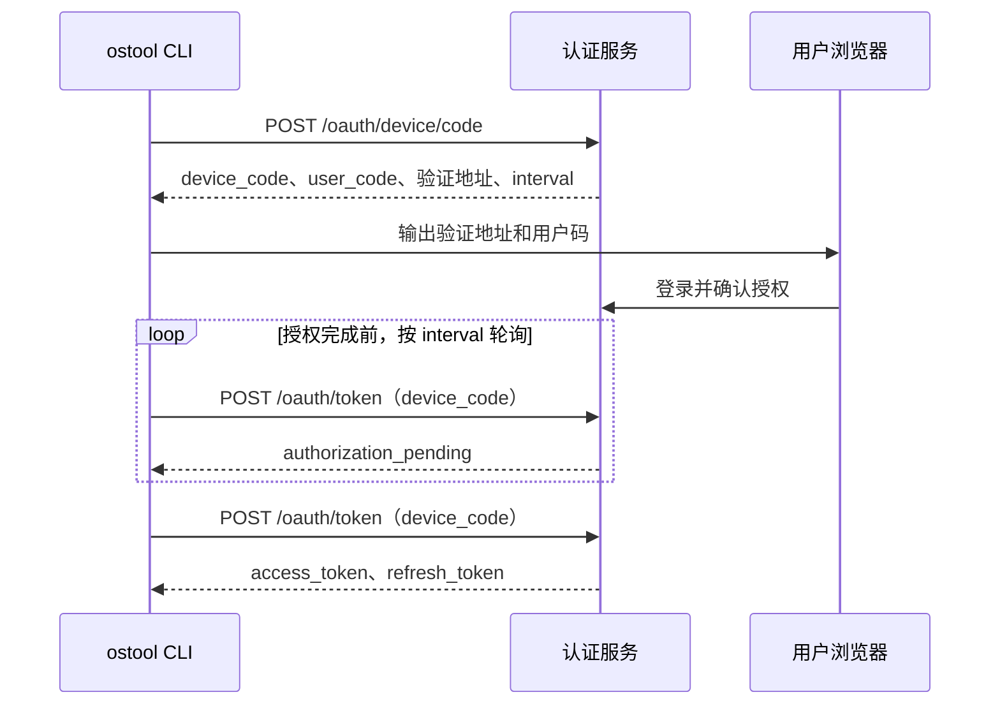

# `ostool` 后端服务 API

`ostool` 同时支持认证模式和本地局域网模式，两种模式连接不同的后端：

- 本地局域网模式使用 `auth_mode = "disabled"`，`ostool` 直接连接 `ostool-server`。`ostool-server` 提供 Board REST API、串口 WebSocket、Management API 和管理后台，不提供登录认证功能。
- 认证模式使用 `auth_mode = "required"`，`ostool` 连接独立的认证后端。该后端提供 OAuth Device Authorization API，并以相同的 Board REST 和串口 WebSocket 契约提供受认证的开发板服务。

本文同时记录上述两类后端使用的接口契约，并不表示单个后端实现文中的全部接口。`ostool` CLI 只调用 OAuth、Board REST 和串口 WebSocket；`/api/v1/admin/...` 及管理后台属于 `ostool-server`，供本地管理使用。

服务地址来自全局或项目配置中的 `board.server`（完整 URL，可包含路径前缀），可被命令行 `--server` 覆盖；可选的 `board.port` 或 `--port` 用于覆盖 URL 中的端口。`auth_mode = "disabled"` 时该地址指向局域网 `ostool-server`；`auth_mode = "required"` 时该地址指向认证后端，OAuth 和受认证的 Board API 共用这个 Base URL。为兼容旧的局域网配置，`board.server` 为裸 IPv4 或 IPv6 地址时客户端自动补为 `http://`。基线版本写出的 `board.server_ip` / `board.port` 也会在读取时迁移为 `board.server` / `board.port`，下一次保存配置时只写新格式；无 scheme 的主机名不支持。

客户端会先把 Base URL 规范化为以 `/` 结尾，再将 HTTP 和 OAuth 接口路径追加到该路径。本文为简洁起见把接口写成 `/api/...` 或 `/oauth/...`；这些是相对于 Base URL 的接口标识，不表示实际请求必须位于域名根目录。例如 Base URL 为 `https://board.example.com/webapp/ostoolmanagephp/` 时，创建会话的实际 URL 是 `https://board.example.com/webapp/ostoolmanagephp/api/v1/sessions`。

- `auth_mode = "required"` 时，`board.server` 必须使用 HTTPS，Board REST 请求和串口 WebSocket 握手携带下文描述的 Bearer Token；OAuth Device Authorization、Token 和撤销请求不携带该 Header；
- `auth_mode = "disabled"`（默认）时通常使用 HTTP，不会发送认证 Header，适合局域网直连 `ostool-server`。

## 网络吞吐测试 API

`ostool-server` 另开专用 HTTP 监听地址，默认 `0.0.0.0:3000`，与默认使用 2999 端口的管理、开发板和会话文件接口分离。该监听器只安装本节路由，没有登录认证，部署时应限制在可信局域网内。它使用 HTTP 原始流测量上传和下载，不兼容 iperf2 协议；`ostool` CLI 的 `board.server` 不指向此端口。

### 测试生命周期

`POST /v1/tests` 创建一个随机 `test_id`，上传和下载各有独立结果，可以使用同一 ID 同时传输。每个方向只能启动一次；开始后不能用同一 ID 重试该方向。`GET /v1/tests/{id}` 返回两个方向的状态和计数。状态依次从 `not_started` 进入 `running`，随后成为 `completed`、`canceled`、`timed_out` 或 `failed` 之一；连接中断、传输错误和超时仍保留可查询的终态。

创建 ID 不占传输并发名额；首次启动上传或下载时才申请，默认最多允许 64 个 ID 同时传输，同一 ID 的双向流只占一个名额。第 65 个并发传输请求立即返回 `429`，该方向仍保持 `not_started`，可以稍后重试。默认传输时限为 3600 秒；未开始的记录 10 分钟过期，最后一个运行方向结束后记录保留 1 小时。内存中最多保留 4096 条记录，满额时优先清除最旧的结束记录。记录不写入磁盘，服务器重启后不再可查询。配置使用 `config.toml` 中的 `[network_test]`；旧配置省略此节时沿用默认值：

```toml
[network_test]
enabled = true
listen_addr = "0.0.0.0:3000"
max_active_tests = 64
max_duration_secs = 3600
```

这些设置由 `ServerConfig.network_test` 读取。`listen_addr` 不能与管理监听器使用同一端口，`max_active_tests` 和 `max_duration_secs` 必须大于 0。`enabled = false` 关闭专用监听器；配置修改需重启服务才会改变监听地址和容量。

### 请求与响应

上传请求体按网络到达的块计数并丢弃，不落盘或整体缓存在内存中。下载响应为 `application/octet-stream`，`bytes=N` 生成指定字节数，`duration_secs=N` 持续到指定时长，两种参数只可选择其一且 `N` 必须为正数；指定时长必须在配置的传输时限内，下载流受 TCP 背压控制。两方向均不设置固定的总字节数上限，计数采用 `u64`。按时长下载时，最终实际字节数需要在传输结束后查询结果。

| 方法与路径 | 成功响应 | 用途 |
| --- | --- | --- |
| `GET /healthz` | `200 OK` | 检查专用监听器是否响应 |
| `POST /v1/tests` | `201 Created`，`{"test_id":"..."}` | 创建测试 ID |
| `PUT /v1/tests/{id}/upload` | `200 OK`，方向结果 JSON | 上传原始请求体，结束后返回计数与吞吐率 |
| `GET /v1/tests/{id}/download?bytes=N` | `200 OK`，原始字节流 | 下载指定字节数 |
| `GET /v1/tests/{id}/download?duration_secs=N` | `200 OK`，原始字节流 | 在指定时长内持续下载 |
| `GET /v1/tests/{id}` | `200 OK`，测试结果 JSON | 查询上传和下载状态 |

结果包含 `test_id` 以及 `upload`、`download` 两个方向对象。每个方向的 `status`、`bytes`、`elapsed_ms`、`bits_per_second` 和 `error` 分别表示状态、服务端处理的字节数、耗时、平均吞吐率及错误；未开始时耗时和吞吐率为 `null`，无错误时 `error` 为 `null`。下载方向的服务端字节数表示已生成的响应体字节；连接中断时客户端实际收到的字节数可能更少，应以客户端收到的数据量核对。上传的 `200 OK` 结果使用同一方向对象格式。

| HTTP 状态 | 原因 |
| --- | --- |
| `400 Bad Request` | 查询参数缺失、冲突或取值无效 |
| `408 Request Timeout` | 上传达到最长运行时限；服务端保留 `timed_out` 结果 |
| `404 Not Found` | 测试 ID 不存在或记录已过期 |
| `409 Conflict` | 同一测试 ID 的同一方向已启动 |
| `429 Too Many Requests` | 启动传输时并发名额已满，或创建 ID 时记录容量已满且没有可淘汰的结束记录 |

上传超时时，连接仍在时返回带 `timed_out` 错误码的 `408` JSON。指定字节数的下载若达到最长运行时限，则已开始的响应体中断，不能再返回新的 HTTP 状态码；使用 `GET /v1/tests/{id}` 可查询 `timed_out` 终态。按时长下载到期属于正常完成。客户端主动断开时也可能收不到错误体，应查询记录。普通开发板会话文件的 `PUT /api/v1/sessions/{session_id}/files` 仍在管理监听器上，继续受它自身的上传大小限制。

### 使用 curl 测试

先创建测试 ID，再把响应中的 UUID 填入 `test_id`。以下命令分别上传和下载 1 GiB，下载文件在客户端丢弃；上传结果直接打印，随后查询双向结果：

```bash
base=http://10.3.10.194:3000
curl -fsS -X POST "$base/v1/tests"
test_id='UUID_FROM_POST_RESPONSE'
dd if=/dev/zero bs=1M count=1024 status=none | curl -fsS -T - "$base/v1/tests/$test_id/upload"
curl -fsS "$base/v1/tests/$test_id/download?bytes=1073741824" -o /dev/null
curl -fsS "$base/v1/tests/$test_id"
```

全双工测试在同一 ID 下并发启动两个请求，各方向各有自己的计数和终态。先创建新 ID 并替换占位符；下面的下载以 30 秒为目标时长，`wait` 可分别检查两个 `curl` 进程的退出状态：

```bash
curl -fsS -X POST "$base/v1/tests"
test_id='UUID_FROM_NEW_POST_RESPONSE'
dd if=/dev/zero bs=1M count=1024 status=none | curl -fsS -T - "$base/v1/tests/$test_id/upload" &
upload_pid=$!
curl -fsS "$base/v1/tests/$test_id/download?duration_secs=30" -o /dev/null &
download_pid=$!
wait "$upload_pid"
wait "$download_pid"
curl -fsS "$base/v1/tests/$test_id"
```

每个方向只能启动一次，第二次示例因此必须使用新 ID。原始流接口无需专用客户端，标准 `curl` 即可发起和查询；这不改变已有 iperf2 服务或板卡测试。

## 通用认证规则

当 `auth_mode = "required"` 时，所有下列 board HTTP 请求和串口 WebSocket 握手均携带：

```http
Authorization: Bearer <access_token>
```

Access Token 选择规则：

1. `OSTOOL_BOARD_ACCESS_TOKEN` 非空时优先使用；该值不保存也不刷新；
2. 否则读取当前 endpoint 保存的一条本地凭据：PAT 直接使用，OAuth Access Token 剩余有效期超过 60 秒时直接使用；
3. OAuth Access Token 剩余有效期不超过 60 秒时，使用保存的 Refresh Token 刷新后再发送请求。

HTTP 客户端不跟随重定向。认证模式下，绝对 WebSocket URL 必须使用 Base URL 对应的 WebSocket scheme（HTTP 对应 `ws`，HTTPS 对应 `wss`），并与 Base URL 使用相同的 host 和有效端口。

## 命令索引

表中未写全的会话路径均以 `/api/v1/sessions/{session_id}` 为前缀。

| 命令 | 基本功能 | `auth_mode = "required"` 时的行为 | 涉及 API |
| --- | --- | --- | --- |
| `ostool login [--server URL] [--port PORT]` | 发起浏览器 Device Authorization 登录。 | 保存 OAuth 凭据；未指定 `--server` 时使用全局 board 配置。 | `POST /oauth/device/code`；`POST /oauth/token`（Device Code 轮询） |
| `ostool login --with-token [--server URL] [--port PORT]` | 从标准输入导入 PAT。 | 保存 PAT；不刷新该 Token。 | 无网络 API |
| `ostool auth status [--server URL] [--port PORT]` | 显示当前 endpoint 的认证状态。 | 显示凭据类型、已知过期时间和 scope，不显示 Token。 | 无网络 API |
| `ostool logout [--server URL] [--port PORT]` | 退出登录。 | OAuth 凭据会尝试远端撤销；随后删除本地凭据。PAT 仅删除本地副本。 | `POST /oauth/revoke`（仅 OAuth） |
| `ostool board ls [--server URL] [--port PORT]` | 查询按类型聚合的可用开发板信息。 | 调用时携带 Bearer Token。 | `GET /api/v1/board-types` |
| `ostool board connect --board-type TYPE [--board-id BOARD_ID] [--server URL] [--port PORT]` | 请求服务端从指定类型中自动分配一块开发板，或指定一块开发板，并打开串口终端。 | REST 和 WebSocket 请求均携带 Bearer Token。 | `POST /api/v1/sessions`；`POST /api/v1/sessions/{session_id}/heartbeat`；WebSocket `/api/v1/sessions/{session_id}/serial/ws`；`DELETE /api/v1/sessions/{session_id}` |
| `ostool board run [--server URL] [--port PORT]` | 构建后请求服务端按 `.board.toml` 的 `board_type` 自动分配开发板并启动。 | REST 和 WebSocket 请求均携带 Bearer Token。 | 始终：`POST /api/v1/sessions`、`POST /api/v1/sessions/{session_id}/heartbeat`、`DELETE /api/v1/sessions/{session_id}`。U-Boot：`GET /boot-profile`、`GET /serial`、`GET /tftp`、`GET /dtb`、`GET /dtb/download`、`PUT /files`、WebSocket `/serial/ws`。HTTP Boot：`GET /boot-profile`、`GET /serial`、可选 `PUT /http-boot/files`、`PUT /http-boot/kernel`、WebSocket `/serial/ws`。 |

## OAuth Device Authorization API

本节接口只由认证模式下的独立认证后端提供，`ostool-server` 不实现这些路由。所有 OAuth 请求使用 `application/x-www-form-urlencoded`。

### 基本原理

该流程是 OAuth 2.0 Device Authorization Grant，适用于 CLI、SSH 和无图形界面环境。它将浏览器中的用户登录与 CLI 获取 Token 分离，使 `ostool` 不接触用户密码，也不需要接收浏览器回调。



第一步只创建短期授权请求：`device_code` 供 CLI 轮询使用，不应展示给用户；`user_code` 用于浏览器授权。用户完成登录和授权前，`/oauth/token` 返回 `authorization_pending`，客户端按服务端给出的轮询间隔继续等待。登录成功后，后续续期仅使用 Refresh Token 调用 `/oauth/token`，不再重新执行设备授权流程。

### 获取设备登录码

```http
POST /oauth/device/code
Content-Type: application/x-www-form-urlencoded

client_id=ostool-cli&scope=board%3Aoperate+offline_access
```

响应至少应包含：

```json
{
  "device_code": "opaque-device-code",
  "user_code": "ABCD-EFGH",
  "verification_uri": "https://board.example.com/activate",
  "verification_uri_complete": "https://board.example.com/activate?user_code=ABCD-EFGH",
  "expires_in": 600,
  "interval": 5
}
```

`verification_uri_complete` 可选；未返回 `interval` 时，客户端默认每 5 秒轮询。

### 使用设备登录码换取 Token

```http
POST /oauth/token
Content-Type: application/x-www-form-urlencoded

grant_type=urn:ietf:params:oauth:grant-type:device_code
&device_code=<device_code>
&client_id=ostool-cli
```

客户端在 `expires_in` 期间按 `interval` 轮询。`authorization_pending` 必须作为非 2xx OAuth 错误响应返回，客户端会继续轮询；`slow_down` 同样必须作为非 2xx OAuth 错误响应返回，客户端会将轮询间隔增加 5 秒。成功的 2xx 响应必须包含下文的完整 Token 字段。

### 刷新 Access Token

```http
POST /oauth/token
Content-Type: application/x-www-form-urlencoded

grant_type=refresh_token
&refresh_token=<refresh_token>
&client_id=ostool-cli
```

当 OAuth Access Token 剩余有效期不超过 60 秒时调用。多个进程共享 Refresh Token 时，客户端会先获得本地跨进程锁，避免并发刷新。

### Token 响应

上述两个 `/oauth/token` 请求均要求返回：

```json
{
  "access_token": "...",
  "refresh_token": "...",
  "token_type": "Bearer",
  "expires_in": 900
}
```

`token_type` 必须为 `Bearer`，`expires_in` 必须为正数，`refresh_token` 必须非空。`scope` 为可选字段。服务端应在刷新时返回轮换后的 Refresh Token。

### 撤销 OAuth 会话

```http
POST /oauth/revoke
Content-Type: application/x-www-form-urlencoded

token=<refresh_token>
&token_type_hint=refresh_token
&client_id=ostool-cli
```

执行 `ostool logout` 时调用。客户端将 HTTP 2xx 和 404 都视为成功；其他错误只会输出警告，随后仍删除本地凭据。

### OAuth 错误响应

认证客户端尝试解析：

```json
{
  "error": "invalid_grant",
  "error_description": "optional detail"
}
```

刷新时若错误包含 `invalid_grant` 或 `invalid_token`，客户端删除本地 OAuth 凭据并要求重新登录。

## Management API

`ostool-server` 的管理页面位于 `/admin`，页面使用同源的 `/api/v1/admin/...` 接口维护开发板、DTB、活动会话、TFTP 和服务器可编辑配置。除 DTB 上传使用原始字节外，请求和响应均使用 JSON。

当前 `ostool-server` 路由本身**没有**为管理页面或 Management API 安装认证、授权或 CSRF 中间件，`ostool` 客户端的 `auth_mode` 也不作用于这些接口。生产部署不得将管理监听地址直接暴露到不可信网络；应通过防火墙、内网隔离或带认证的反向代理保护 `/admin` 和 `/api/v1/admin/...`。这些接口可以持久化电源命令、设备路径和服务配置，应按特权管理入口对待。

### 接口索引

| 功能 | 方法与路径 |
| --- | --- |
| 管理概览 | `GET /api/v1/admin/overview` |
| 开发板列表与创建 | `GET /api/v1/admin/boards`；`POST /api/v1/admin/boards` |
| 单块开发板 | `GET /api/v1/admin/boards/{board_id}`；`PUT /api/v1/admin/boards/{board_id}`；`DELETE /api/v1/admin/boards/{board_id}` |
| 开发板电源状态 | `GET /api/v1/admin/boards/{board_id}/power-status` |
| 开发板租约状态 | `GET /api/v1/admin/boards/{board_id}/runtime-status` |
| 串口与网卡发现 | `GET /api/v1/admin/serial-ports`；`GET /api/v1/admin/network-interfaces` |
| axloader 设备发现 | `GET /api/v1/admin/loader-devices` |
| QEMU 虚拟设备 | `GET /api/v1/admin/virtual-devices`；`POST /api/v1/admin/virtual-devices`；`DELETE /api/v1/admin/virtual-devices/{device_id}` |
| DTB 列表与创建 | `GET /api/v1/admin/dtbs`；`POST /api/v1/admin/dtbs` |
| 单个 DTB | `GET /api/v1/admin/dtbs/{dtb_name}`；`PUT /api/v1/admin/dtbs/{dtb_name}`；`DELETE /api/v1/admin/dtbs/{dtb_name}` |
| 活动会话 | `GET /api/v1/admin/sessions`；`DELETE /api/v1/admin/sessions/{session_id}` |
| TFTP 配置 | `GET /api/v1/admin/tftp`；`PUT /api/v1/admin/tftp` |
| TFTP 状态与协调 | `GET /api/v1/admin/tftp/status`；`POST /api/v1/admin/tftp/reconcile` |
| 服务器配置 | `GET /api/v1/admin/server-config`；`PUT /api/v1/admin/server-config` |

### 管理概览

```http
GET /api/v1/admin/overview
```

成功返回 `200 OK`：

```json
{
  "board_count_total": 3,
  "board_count_available": 1,
  "disabled_board_count": 1,
  "active_session_count": 1,
  "board_types": [
    {
      "board_type": "OrangePi-5-Plus",
      "tags": ["arm64", "lab"],
      "total": 2,
      "available": 1
    }
  ],
  "tftp_status": {
    "provider": "builtin",
    "enabled": true,
    "healthy": true,
    "writable": true,
    "resolved_server_ip": "192.168.1.2",
    "resolved_netmask": "255.255.255.0",
    "root_dir": "/var/lib/ostool-server/tftp-root",
    "bind_addr_or_address": "0.0.0.0:69",
    "service_state": null,
    "last_error": null
  },
  "server": {
    "listen_addr": "0.0.0.0:2999",
    "data_dir": "/var/lib/ostool-server",
    "board_dir": "/var/lib/ostool-server/boards",
    "dtb_dir": "/var/lib/ostool-server/dtbs",
    "http_boot_public_base_url": null,
    "dtb_upload_max_mib": 10
  }
}
```

`board_count_total` 包含禁用开发板；`board_count_available` 只统计未禁用且租约状态为 `idle` 的开发板。`board_types` 与公开的开发板类型接口使用相同聚合规则，不包含禁用开发板。`active_session_count` 不包含已进入 `releasing` 状态的会话。

### 开发板管理

```http
GET /api/v1/admin/boards
GET /api/v1/admin/boards/{board_id}
```

列表接口返回 `BoardConfig` 数组，单板接口返回一个 `BoardConfig`。axloader 写入时将 `serial` 规范化为 `null`。读取手动串口配置时服务端会尝试解析串口稳定标识；解析成功后，`serial` 中会额外出现 `resolved_device_path` 和可选的 `resolved_usb_path`。

创建和更新使用相同请求结构：

```http
POST /api/v1/admin/boards
PUT /api/v1/admin/boards/{board_id}
Content-Type: application/json

{
  "id": null,
  "board_type": "OrangePi-5-Plus",
  "tags": ["arm64", "lab"],
  "notes": "RK3588 development board",
  "disabled": false,
  "serial": {
    "key": {
      "kind": "usb_path",
      "value": "pci-0000:00:14.0-usb-0:2.1"
    },
    "baud_rate": 1500000
  },
  "power_management": {
    "kind": "custom",
    "power_on_cmd": "board-power OrangePi-5-Plus-1 on",
    "power_off_cmd": "board-power OrangePi-5-Plus-1 off"
  },
  "boot": {
    "kind": "uboot",
    "use_tftp": true,
    "dtb_name": "rk3588-orangepi-5-plus.dtb",
    "kernel_load_addr": "0x00280000",
    "fit_load_addr": "0x10000000",
    "bootm_addr": "0x10000000",
    "network_mode": "dhcp",
    "board_ip": null,
    "server_ip": null,
    "netmask": null,
    "gatewayip": null
  }
}
```

字段约束如下：

- 创建时 `id` 为 `null` 或空字符串，服务端自动选择首个可用的 `{board_type}-{number}`；指定的 ID 已存在时返回 `409 Conflict`。
- 更新时 `id` 为 `null` 保持路径中的 `board_id`，指定不同 ID 表示重命名。只有租约状态为 `idle` 的开发板可以更新或删除，否则返回 `409 Conflict`。
- `board_type`、串口 key、Custom 电源命令不能为空；配置串口时 `baud_rate` 必须大于 0。请求中的 `resolved_device_path` 和 `resolved_usb_path` 会被清除，由服务端重新发现。
- `serial.key.kind` 可为 `serial_number`、`usb_path` 或 `qemu`。`qemu` 的 value 是虚拟设备 ID。
- `power_management.kind` 可为上例的 `custom`，或中盛继电器配置：

  ```json
  {
    "kind": "zhongsheng_relay",
    "key": {"kind": "usb_path", "value": "pci-0000:00:14.0-usb-0:2.2"}
  }
  ```

  启用内建虚拟板时也可使用 `{"kind":"qemu","virtual_device_id":"..."}`。此时 axloader 配置使用 `serial: null`，串口 provider 从电源取得，并配置相同虚拟设备的 MAC。

- `boot.kind` 可为上例的 `uboot`、`{"kind":"pxe","notes":null}`，或 `{"kind":"httpboot","serial_parameters":null}`。`httpboot` 是唯一现行 wire kind；`uefi_http`、`boot_arch` 及其他旧字段均按未知字段拒绝，不自动迁移、忽略或重写。`httpboot.serial_parameters` 是可选的宿主串口覆盖，包含 `baud_rate`、`data_bits`（7/8）、`parity`（`none`/`odd`/`even`/`mark`/`space`）、`stop_bits`（`one`/`one_point_five`/`two`）和 `flow_control`（`none`/`rts_cts`）；配置后优先于 axloader 本次上报，省略或为 `null` 时采用上报值，固件无法提供时采用 115200/8N1/无流控。物理宿主后端保存配置时只接受 `none`/`odd`/`even` 和 1/2 stop bits，`mark`/`space` 或 1.5 stop bits 会明确拒绝；覆盖必须与实际串口输出一致，否则身份帧无法绑定。
- 部署升级前必须人工修正旧 `boot_arch`、`uefi_http` 和已删除的 `loader_network.public_base_url`。服务端按当前格式解析错误，不增加迁移分支，也不删除无关历史文件。
- `httpboot` 板卡必须提供 `network_identity: {"mac_address":"02:00:00:00:00:01"}`。MAC 会规范化为小写六字节冒号格式并在全部板卡配置中保持唯一；重复绑定返回 `409` 和错误码 `mac_already_bound`。`board_type` 始终由管理员填写，不根据 SMBIOS 或架构推断。
- U-Boot `network_mode` 可为 `dhcp` 或 `static_ip`。未启用 TFTP 或使用 DHCP 时服务端清除静态网络字段；使用 `static_ip` 时 `board_ip` 必填，所有已提供的网络字段必须是 IPv4 地址。`dtb_name` 必须符合单层 DTB 文件名格式，但创建或更新开发板时不会检查对应文件是否已经上传。

创建成功返回 `201 Created` 和规范化后的 `BoardConfig`；更新成功返回 `200 OK`。删除请求没有请求体，成功返回 `204 No Content`：

```http
DELETE /api/v1/admin/boards/{board_id}
```

### 开发板状态与硬件发现

电源状态和租约状态是只读接口：

```http
GET /api/v1/admin/boards/{board_id}/power-status
GET /api/v1/admin/boards/{board_id}/runtime-status
```

响应示例：

```json
{
  "available": false,
  "powered": null,
  "last_action": null,
  "updated_at": null
}
```

```json
{
  "lease_state": "idle",
  "active_session_id": null,
  "last_release_error": null,
  "updated_at": "2026-07-30T06:00:00Z"
}
```

当前 `ostool-server` 只用该接口确认开发板是否存在，尚未维护可查询的实时电源状态，因此对存在的开发板固定返回 `available: false`，其余三个字段为 `null`。响应模型为后续电源状态后端预留了 `powered`、`last_action` 和 `updated_at`；实现这些字段后，`last_action` 可为 `power_on` 或 `power_off`。`lease_state` 可为 `idle`、`using`、`releasing` 或 `error`。

硬件发现接口读取服务器当前可见的串口和网络接口：

```http
GET /api/v1/admin/serial-ports
GET /api/v1/admin/network-interfaces
```

串口响应是如下对象的数组：

```json
[
  {
    "current_device_path": "/dev/ttyUSB0",
    "port_type": "usb",
    "label": "/dev/ttyUSB0 · USB Serial",
    "primary_key_kind": "serial_number",
    "primary_key_value": "ABC123",
    "usb_path": "pci-0000:00:14.0-usb-0:2.1",
    "stable_identity": true,
    "usb_vendor_id": 6790,
    "usb_product_id": 29987,
    "manufacturer": "QinHeng Electronics",
    "product": "USB Serial",
    "serial_number": "ABC123"
  }
]
```

无法发现的可选字段为 `null`。网络接口响应示例：

```json
[
  {
    "name": "eth0",
    "label": "eth0 · 192.168.1.2",
    "ipv4_addresses": ["192.168.1.2"],
    "netmask": "255.255.255.0",
    "loopback": false
  }
]
```

枚举失败时返回 `503 Service Unavailable`。

### axloader 发现与虚拟设备

```http
GET /api/v1/admin/loader-devices
```

返回当前内存探测表，包括永久/当前 MAC、原始 `arch` 字符串、`boot_epoch`、loader 版本、SMBIOS Type 1 摘要、最近出现时间、在线状态、冲突状态和实时解析出的 `bound_board_id`。10 秒未上报视为离线，记录保留 24 小时；绑定关系始终从板卡 TOML 按 MAC 计算，不单独持久化。Web UI 只为 `bound_board_id = null` 的设备提供“创建配置”；编辑页只读显示 axloader 上报架构，包括 `future-isa` 等未枚举名称，离线或未发现时显示未知。`arch` 不参与准入；MAC、`boot_epoch` 和串口身份正确时，离线准备的 Session/内核可等待设备上线后启动。

内建 QEMU 默认关闭。启用时在服务端配置中提供实际 QEMU、OVMF 和 axloader
产物路径，并声明隔离网络及 TAP 池：

```toml
[virtual_qemu]
enabled = true
qemu_binary = "/usr/bin/qemu-system-x86_64"
ovmf_code = "/usr/share/OVMF/OVMF_CODE_4M.fd"
ovmf_vars = "/usr/share/OVMF/OVMF_VARS_4M.fd"
axloader_efi = "/opt/ostool/BOOTX64.EFI"
runtime_dir = "/var/lib/ostool-server/qemu"
network_namespace = "ostool-qemu"
bridge = "ostool-br0"
tap_pool = ["ostool-tap0", "ostool-tap1"]
memory_mib = 512
cpus = 2
```

启用后可管理真实 QEMU 进程：

```http
GET /api/v1/admin/virtual-devices
POST /api/v1/admin/virtual-devices
Content-Type: application/json

{"mac_address":"02:00:00:00:00:09"}

DELETE /api/v1/admin/virtual-devices/{device_id}
```

GET 返回 `{ "enabled": false, "devices": [] }` 或当前设备列表。POST 的 MAC 可省略，由服务生成本地管理、单播 MAC；成功返回 `201 Created`。虚拟设备必须经真实 UDP/HTTP 发现后才能绑定，管理接口不会注入探测记录。已被板卡配置引用的设备不能删除。

虚拟环境由服务端子命令幂等管理：

```bash
ostool-server --config .ostool-server.toml virtual-lab up
ostool-server --config .ostool-server.toml virtual-lab status
ostool-server --config .ostool-server.toml virtual-lab down
```

默认创建独立 network namespace、bridge、veth、dnsmasq 和当前用户拥有的 TAP 池，客户机网段为 `10.77.0.0/24`，服务端地址为 `10.77.0.1`。该操作需要 Linux `CAP_NET_ADMIN`。
完整绑定约束与逐步验收流程见 [内建 QEMU 虚拟板](axloader-network-control.md#3-内建-qemu-虚拟板)。

### DTB 管理

```http
GET /api/v1/admin/dtbs
GET /api/v1/admin/dtbs/{dtb_name}
```

列表接口返回数组，单文件接口返回：

```json
{
  "name": "rk3588-orangepi-5-plus.dtb",
  "size": 131072,
  "updated_at": "2026-07-30T06:00:00Z",
  "relative_tftp_path_template": "boot/dtb/rk3588-orangepi-5-plus.dtb"
}
```

创建 DTB 使用原始文件体：

```http
POST /api/v1/admin/dtbs
X-Dtb-Name: rk3588-orangepi-5-plus.dtb
Content-Type: application/octet-stream

<raw DTB bytes>
```

文件名必须是合法的单层名称，请求体不能为空且最大为 10 MiB。创建成功返回 `201 Created`；同名文件已存在时返回 `409 Conflict`。

更新接口可以重命名、替换内容或同时执行两者：

```http
PUT /api/v1/admin/dtbs/{dtb_name}
X-Dtb-Name: new-name.dtb          # 可选；省略则不重命名
Content-Type: application/octet-stream

<optional replacement bytes>
```

只重命名时允许空请求体；未提供 `X-Dtb-Name` 且没有替换内容时返回 `400 Bad Request`。重命名会同步修改所有开发板 U-Boot 配置中的 `dtb_name` 引用。成功返回更新后的 DTB 元数据。

```http
DELETE /api/v1/admin/dtbs/{dtb_name}
```

删除成功返回 `204 No Content`。仍被任一开发板引用时返回 `409 Conflict`，不存在时返回 `404 Not Found`。

### 活动会话管理

```http
GET /api/v1/admin/sessions
```

成功返回 `200 OK`：

```json
{
  "sessions": [
    {
      "id": "f0ff8a82-6265-4534-a030-d01df7bc7eb9",
      "board_id": "OrangePi-5-Plus-1",
      "client_name": "ostool",
      "created_at": "2026-07-30T06:00:00Z",
      "last_heartbeat_at": "2026-07-30T06:00:05Z",
      "expires_at": "2026-07-30T06:00:15Z",
      "serial_connected": true,
      "state": "active"
    }
  ]
}
```

`state` 可为 `active` 或 `releasing`。管理端释放会话使用：

```http
DELETE /api/v1/admin/sessions/{session_id}
```

成功返回 `202 Accepted` 且没有响应体。释放是异步过程，期间会话可能继续出现在列表中并处于 `releasing`；不存在时返回 `404 Not Found`。

### TFTP 管理

```http
GET /api/v1/admin/tftp
PUT /api/v1/admin/tftp
Content-Type: application/json
```

读取响应使用 `{"tftp": <TftpConfig>}` 包装；更新请求体直接是 `TftpConfig`。内置 provider 示例：

```json
{
  "provider": "builtin",
  "enabled": true,
  "root_dir": "/var/lib/ostool-server/tftp-root",
  "bind_addr": "0.0.0.0:69"
}
```

systemd `tftpd-hpa` provider 示例：

```json
{
  "provider": "system_tftpd_hpa",
  "enabled": true,
  "root_dir": "/srv/tftp",
  "config_path": "/etc/default/tftpd-hpa",
  "service_name": "tftpd-hpa",
  "username": "tftp",
  "address": ":69",
  "options": "-l -s -c",
  "manage_config": false,
  "reconcile_on_start": true
}
```

更新时服务端创建 `root_dir`、启动新 provider，并对 `system_tftpd_hpa` 立即执行协调；成功后持久化配置并返回 `200 OK`。启动或协调失败时返回 `503 Service Unavailable`，旧 manager 保持生效。

```http
GET /api/v1/admin/tftp/status
POST /api/v1/admin/tftp/reconcile
```

状态响应使用 `{"status": <TftpStatus>}` 包装，`TftpStatus` 字段格式与管理概览中的 `tftp_status` 相同。`reconcile` 没有请求体，用于立即应用当前 provider 配置并在成功后返回最新状态；失败返回 `503 Service Unavailable`。

### 服务器配置管理

```http
GET /api/v1/admin/server-config
```

成功返回只读和可编辑配置：

```json
{
  "readonly": {
    "listen_addr": "0.0.0.0:2999",
    "data_dir": "/var/lib/ostool-server",
    "board_dir": "/var/lib/ostool-server/boards",
    "dtb_dir": "/var/lib/ostool-server/dtbs",
    "http_boot_public_base_url": null,
    "dtb_upload_max_mib": 10
  },
  "editable": {
    "network": {
      "interface": "eth0"
    },
    "upload_limits": {
      "session_file_max_mib": 64
    }
  }
}
```

更新请求只接受可编辑部分：

```http
PUT /api/v1/admin/server-config
Content-Type: application/json

{
  "network": {
    "interface": "eth0"
  },
  "upload_limits": {
    "session_file_max_mib": 64
  }
}
```

`network.interface` 不能为空，`session_file_max_mib` 必须大于 0。成功后配置立即持久化，并返回与 GET 相同的完整响应。`readonly` 中的监听地址、数据目录、HTTP Boot 公网地址和 DTB 上传上限不能通过此接口修改。

## Board REST API

本节定义两种后端共用的开发板服务契约：本地局域网模式由 `ostool-server` 直接提供，认证模式由独立认证后端提供受认证的对应接口。这里覆盖 `ostool-server` 的全部公开、非管理 REST 接口。`ostool` 当前命令会使用会话文件上传；配置宿主 initramfs 时还会调用普通 HTTP Boot 文件上传。它不直接调用会话详情、会话文件列表/查询/删除和显式电源控制；这些仍属于公开 board 服务契约，其中显式电源控制也已有 `BoardServerClient` 方法。

axloader 只接入 v7。UDP announcement 与设备 `GET /api/v1/status` 的 `protocol_version` 必须为 `7`；server→device 的 boot、serial、OTA mutation 统一携带 `X-Axloader-Protocol-Version: 7`。缺失、非数字或不等同于 7 时，设备端在解析请求体、写文件或修改事务前返回 `400`：`{"code":"unsupported_protocol","message":"axloader protocol 7 is required"}`。UART 身份帧仍是独立的 `AXLOADER-SERIAL/1` 格式。旧 poll/status 路由不存在，也不提供用于升级的旧协议桥接。

部署切换时先暂停新 session 和 OTA 任务，完成或取消活动旧 OTA 并确认设备退出 pending/trial；停止旧 server 后备份并人工整理板卡配置中的 `boot_arch`/`uefi_http`、删除 `loader_network.public_base_url`，同时按当前 `boot_epoch` 形状整理 `loader-ota/devices.json`。用现有刷写/恢复方式安装 v7 axloader 和配套 CLI/server 后重新发现并验证。不要删除 `loader-ota/jobs.json`、镜像历史、板卡身份、电源配置或设备侧回滚记录。

服务器只保留 `GET /api/v1/sessions/{session_id}/loader-status` 查询 session 当前 boot 状态；响应中的 `boot_epoch` 在尚未关联设备时为 `null`。axloader 上报的 `arch` 是开放字符串，只用于诊断和 UI 显示。设备准入与关联核对永久 MAC、当前启动代次 `boot_epoch`、UART `serial_id` 和 binding，不再比较 arch。

服务器先从当前 UART 身份帧确认物理连线，以本次参数接管租约，再通过网络 continue 和 `X-Serial-Binding` 放行启动。设备 `POST /api/v1/boot/jobs` 创建事务返回 `201`，相同清单重试返回 `200`，冲突清单返回 `409`。清单仅包含 `boot_id`、kernel 长度/SHA-256、可选 initramfs 长度/SHA-256 和可选 cmdline；不传 `arch`、`image_format` 或 `entry_symbol`。内核与 initramfs 四种有/无组合均有效。服务器仅做 session 路径、长度、摘要和互斥校验，不解析 ELF、不选择 EFI 入口；实际镜像 machine、格式、符号和装载约束由设备本地与 axloader 交接链决定。观察到同代次其他启动 ID 时，服务端最多删除旧事务并重试创建一次。`POST /api/v1/boot/jobs/{id}/start` 和 `PUT /api/v1/ota/image` 被接受返回 `202`；`202` 只表示准备交接或升级暂存，不表示内核已运行。`POST /api/v1/ota/confirm` 成功返回 `200`，代次、来源或升级 ID 不匹配返回 `409`。

设备明确返回 `400`、`413` 或 `422` 时，服务端读取受限响应体并解码顶层 `{code,message}`，发布 session loader `failed`、令串口状态进入 `Failed`，随后沿现有释放流程结束。设备 `failed` 状态和首个错误可查询，后续同一 boot ID 的迟到更新不会清除该错误。`start` 发出后网络中断、超时、`409` 或 `5xx` 时只查询相同 `boot_epoch + boot_id`：`failed` 重放首个 code/message；仅当设备仍回报 `ready` 才可重发同 ID start 一次；其他情况显示交接结果未确认并保留当前串口 lease/console observation，直到串口关闭、session timeout 或显式取消。同一 boot generation 的后续 announcement 不会重新 create/upload/start；只有显式电源新测试或新 boot command 清除观察。服务器不会自动 DELETE、重建任务、更换 boot ID 或跨代启动。无法解码的设备错误体报告 `invalid_device_response`，保留 HTTP 状态和受限原文；读取失败或超过上限的响应会明确标记，截断 JSON 不会被当作完整错误。

装载器镜像库和指派任务使用下列 ostool-server 接口：

| 方法与路径 | 成功结果 | 主要冲突或校验错误 |
| --- | --- | --- |
| `GET /api/v1/admin/loader-images` | `200`，返回持久镜像元数据列表 | 镜像库读取失败返回 `500` |
| `POST /api/v1/admin/loader-images` | `201`，按请求体保存不透明镜像字节并返回 SHA-256、长度和可选 `X-Image-Version` | 空请求体、缺少/错误/不匹配的 `Content-Length` 或无效版本返回 `400`，超过 32 MiB 返回 `413`；不解析 PE/COFF 或 `Machine` |
| `DELETE /api/v1/admin/loader-images/{sha256}` | `204`，删除未被活动任务引用的 EFI 文件和元数据 | 摘要无效返回 `400`，镜像不存在返回 `404`，仍被非终态任务引用返回 `409` |
| `GET /api/v1/admin/boards/{board_id}/loader-updates` | `200`，返回该板卡当前任务或 `null` | 未知板卡返回 `404` |
| `POST /api/v1/admin/boards/{board_id}/loader-updates` | `201`，为 HTTP Boot 板卡创建绑定当前 MAC 的独立升级 ID；离线可先排队，不限制 CPU 架构 | 启动类型不支持、缺少 MAC 或身份冲突、板卡租约非空闲/已有 Session、已有非终态任务、设备有未确认升级或镜像已激活时返回 `409` |
| `DELETE /api/v1/admin/boards/{board_id}/loader-updates/{update_id}` | `200`，取消任意非终态任务并返回 `cancelled` 任务 | ID 已被替代或任务已经终结返回 `409` |

OTA 镜像对服务端是不透明的字节对象。`OtaStore` 接受非空且不超过 `MAX_IMAGE_BYTES`（32 MiB）的内容，保存标签、长度和 SHA-256，并在下发前验证文件完整性。axloader 独占 PE/COFF 格式、`Machine`、EFI Subsystem、平台加载限制及 A/B 试运行判断；server 和 Web UI 不用 CPU 架构判定 OTA 资格。旧 `GET /api/v1/loader-updates/{update_id}/image` 和 `POST /api/v1/loaders/ota-status` 已删除；现行链路由 server 反向调用设备 OTA 接口并从 `/status` 收敛 trial/confirm/rollback。

v7 的 `device::push_ota_image()` 复用设备 `PUT /api/v1/ota/image`，携带 `X-Axloader-Protocol-Version: 7`、`X-Boot-Epoch`、`X-Image-Sha256`、`X-Update-Id`、`X-Update-Source: server` 和准确的 `Content-Length`。服务端读取受限响应体，优先解码顶层 `{code,message}`；错误通过 `Job.error` 和现有 API/SSE 展示。设备响应的处理规则为：

| 设备结果 | 服务端行为 |
| --- | --- |
| `202 Accepted` | 镜像已校验并暂存，任务进入 `staged`；不表示最终升级成功 |
| `400 Bad Request` | 请求头或参数等请求错误，本次任务直接 `failed`，不重传相同镜像 |
| `413 Payload Too Large` | 超出设备限额，本次任务直接 `failed`，不重传相同镜像 |
| `422 Unprocessable Content` | 摘要、格式、`Machine` 或平台兼容性等确定性拒绝，本次任务直接 `failed`，不重传相同镜像 |
| `409 Conflict` | 刷新实际设备状态/启动代次，至少等待重试间隔后按状态决定是否再发；不消耗传输失败重试次数 |
| `503 Service Unavailable` | 保留等待/不可用原因，直到 OTA 状态、能力或启动代次变化才重新尝试，不持续重复 PUT |
| 网络中断、超时及其他 `5xx` | 持久记录错误并有限退避，最多三次投递失败；结果不确定时先核对设备状态和升级 ID，最后一次也先核对再判定失败 |

确定性拒绝至少保留 HTTP 状态、错误 code/message 及受限响应原文；读取拒绝响应体失败时保留 HTTP 状态和读取错误，仍不重传。升级 ID 匹配本任务的已暂存镜像不会再次下发；进入试运行后，仍要求来源为 `server` 且运行摘要匹配才能确认。缺失实际 `ota` 状态时任务等待并显示原因，不盲目发送，也不永久判为格式或架构错误。镜像格式和兼容性由接收它的 axloader 校验，并经后续 `/status` 收敛。

OTA 镜像和任务独立于 Session 持久保存，服务端重启后继续使用原升级 ID。空闲检查只限制新镜像下发；若设备已运行本任务对应、来源为 `server` 且运行摘要匹配的新槽，即使板卡已经进入活动 Session，服务端也会先确认该槽。只有设备实际运行新槽、持久确认且激活摘要匹配后，任务才进入 `succeeded`。重复或旧代次上报不能改写终态，也不能覆盖最初的终态失败原因。取消非终态任务不会远程改写设备状态，已进入待试槽的设备在未获确认时按自身 A/B 规则回滚。非终态任务引用的镜像不能删除；删除终态任务曾引用的镜像只回收镜像文件和元数据，任务中保存的摘要、版本和长度仍可用于审计。

`Job` 在原有 `phase`、`error` 和 `delivery_attempts` 之外提供以下调度字段，随任务查询及 `ota` SSE 资源返回。客户端兼容旧服务器时应允许字段缺失；旧持久任务缺失字段时也按下列默认值恢复。

| JSON 字段 | 类型与默认值 | 含义 |
| --- | --- | --- |
| `next_delivery_at` | UTC 时间戳字符串或 `null`，默认 `null` | 下次允许投递的最早时间；到期后仍须核对设备状态和任务资格 |
| `waiting_for_device_change` | 布尔值，默认 `false` | 当前因设备不可用而等待 OTA 状态、能力或启动代次变化；不能靠时间到期持续重发 |

等待原因通过已有 `error` 展示。这些字段控制重试调度，不改变终态、取消或试运行确认条件。

### 查询开发板类型

```http
GET /api/v1/board-types
```

用于 `ostool board ls`。客户端只接受 `ostool-server` 的已聚合开发板类型列表：

```json
[
  {
    "board_type": "rk3568",
    "tags": [],
    "total": 2,
    "available": 1
  }
]
```

每个 `board_type` 仅有一个聚合条目：`total` 是该类型未禁用开发板的数量，`available` 是其中租约状态为 idle 的数量，`tags` 是该类型所有未禁用开发板标签的去重并集。该接口不返回 `board_id`；创建会话时由服务端自动选择实际开发板，并在成功响应中返回 `board_id`。

### 创建会话

```http
POST /api/v1/sessions
Content-Type: application/json

{
  "board_type": "rk3568",
  "board_id": "rk3568-02",
  "required_tags": [],
  "client_name": "ostool"
}
```

用于 `ostool board connect` 和 `ostool board run`。`board_type` 必填，`board_id` 可选，`required_tags` 由当前 CLI 固定发送空数组，`client_name` 固定为 `ostool`。未提供 `board_id` 时，服务端在满足类型和标签条件的空闲开发板中自动分配；提供时只分配该 ID 对应的、类型匹配、未禁用且空闲的开发板。CLI 通过 `ostool board connect -b <BOARD_TYPE> --board-id <BOARD_ID>` 使用此能力；`--board-type` 仍是必填参数。

服务端会对 `board_id` 做首尾空白清理，清理后为空的值返回 `400`。不存在的开发板返回 `404`，开发板类型不匹配返回 `400`，指定开发板不可用时返回 `409`。客户端会将 CLI 参数规范化后发送，并在创建成功后校验响应中的 `board_id`；如果服务端返回了另一块开发板，客户端会尽力使用 `DELETE /api/v1/sessions/{session_id}` 释放刚创建的会话，然后报错，不会静默连接错误设备。

成功时返回 `201 Created`：

```json
{
  "session_id": "...",
  "board_id": "rk3568-01",
  "lease_expires_at": "2026-07-20T02:00:10Z",
  "serial_available": true,
  "boot_mode": "uboot",
  "ws_url": "api/v1/sessions/.../serial/ws"
}
```

`ws_url` 在非 axloader 模式且没有串口配置时为 `null`。axloader 的 `serial: null` 仍提供 WebSocket，先建立接收通道再上电和自动绑定。为兼容包含路径前缀的 Base URL，认证后端应返回不以 `/` 开头的 Base URL 相对路径，或者返回包含完整路径前缀的同源绝对 `ws://`/`wss://` URL。以 `/` 开头的值是 origin-relative URL，只适用于 API 确实部署在域名根目录的情况。

`boot_mode` 可为 `uboot`、`pxe` 或 `httpboot`。

当前 `ostool-server` 的固定会话 TTL 为 10 秒，每次心跳会把到期时间更新为服务端当前时间之后 10 秒；`ostool` 在成功创建会话后每秒发送一次心跳。独立认证后端可以采用不同 TTL，但必须返回真实的 `lease_expires_at` 并在心跳时续租。

指定类型不存在时返回 `404`；类型存在但没有符合条件的空闲开发板时返回 `409`。未指定 `board_id` 时，只有结构化错误中的 `code` 恰好为 `conflict`，且 `message` 与服务端生成的 `no available board for type …` 完全匹配，客户端才会每秒重试。指定 `board_id` 且该板卡忙时，服务端返回与 `board <BOARD_ID> is not available` 对应的结构化错误，客户端同样每秒重试；其他错误直接返回给调用者。

`board_id` 是向后兼容的可选 JSON 字段。旧客户端不发送该字段，仍按类型自动分配。新客户端连接会忽略未知 JSON 字段但仍按类型分配的旧服务端时，会通过成功响应中的 `board_id` 检测到服务端未执行指定分配，尽力释放该会话并报错；因此不会因为旧服务端静默忽略字段而连接到另一块真实设备。若旧服务端拒绝未知字段，则直接返回其错误。

### 查询会话详情

```http
GET /api/v1/sessions/{session_id}
```

请求没有请求体，成功返回 `200 OK`：

```json
{
  "session": {
    "id": "...",
    "board_id": "rk3568-01",
    "client_name": "ostool",
    "created_at": "2026-07-20T02:00:00Z",
    "last_heartbeat_at": "2026-07-20T02:00:01Z",
    "expires_at": "2026-07-20T02:00:11Z",
    "serial_connected": false,
    "state": "active"
  },
  "board": {
    "id": "rk3568-01",
    "board_type": "rk3568",
    "tags": ["lab"],
    "serial": null,
    "power_management": {
      "kind": "custom",
      "power_on_cmd": "power-on",
      "power_off_cmd": "power-off"
    },
    "boot": {
      "kind": "uboot",
      "use_tftp": true,
      "dtb_name": null,
      "kernel_load_addr": null,
      "fit_load_addr": null,
      "bootm_addr": null,
      "network_mode": "dhcp",
      "board_ip": null,
      "server_ip": null,
      "netmask": null,
      "gatewayip": null
    },
    "notes": null,
    "disabled": false
  },
  "serial_available": false,
  "serial_connected": false,
  "files": []
}
```

`session.state` 为会话生命周期状态；`board.serial`、`board.notes` 可为 `null`。`files` 的元素使用下方“上传会话文件”中的文件响应格式。

### 会话保活与释放

```http
POST /api/v1/sessions/{session_id}/heartbeat
DELETE /api/v1/sessions/{session_id}
```

两个请求均没有请求体。心跳成功返回 `200 OK`；会话正在释放时返回 `409 Conflict`：

```json
{
  "session_id": "...",
  "lease_expires_at": "2026-07-20T02:00:12Z"
}
```

删除成功时服务端返回 `202 Accepted` 且没有响应体；这只表示服务端已经接受异步释放请求。
服务端会等待会话任务退出、关闭开发板电源并清理会话文件，全部完成后才删除会话并把开发板
恢复为 `idle`。若释放步骤因串口或继电器短暂不可用而失败，会话会保持 `releasing`，
开发板 runtime 保留对应的 `active_session_id` 和 `last_release_error`，服务端每 5 秒重试
尚未完成的步骤；重试成功前该开发板不会重新分配。删除不存在的会话时返回 `404`，客户端也
将其视为已释放。

### 获取启动配置

```http
GET /api/v1/sessions/{session_id}/boot-profile
```

请求没有请求体，成功返回 `200 OK`。`boot.kind` 决定 `boot` 对象的具体字段：

```json
{
  "boot": {
    "kind": "uboot",
    "use_tftp": true,
    "dtb_name": "board.dtb",
    "kernel_load_addr": "0x80200000",
    "fit_load_addr": "0x82200000",
    "bootm_addr": "0x82200000",
    "network_mode": "dhcp",
    "board_ip": null,
    "server_ip": null,
    "netmask": null,
    "gatewayip": null
  },
  "server_ip": "192.168.1.2",
  "netmask": "255.255.255.0",
  "interface": "eth0",
  "http_base_url": "http://192.168.1.2:2999/"
}
```

`boot.kind` 可为 `uboot`、`pxe` 或 `httpboot`。`pxe` 的对象仅含可选 `notes`；`httpboot` 的对象只含可选 `serial_parameters`，不接受 `uefi_http` 或 `boot_arch`。HTTP Boot 的 MAC 位于顶层 `network_identity.mac_address`，不属于 boot profile。顶层 `server_ip`、`netmask`、`interface`、`http_base_url` 均可为 `null`。`server_ip` 和 `http_base_url` 使用板端可访问的网络地址，不一定等于管理网地址。

### 获取串口状态

```http
GET /api/v1/sessions/{session_id}/serial
```

请求没有请求体，成功返回 `200 OK`：

```json
{
  "available": true,
  "connected": false,
  "port": "/dev/ttyUSB0",
  "baud_rate": 115200,
  "ws_url": "api/v1/sessions/.../serial/ws"
}
```

非 axloader 模式没有串口时，`available` 和 `connected` 为 `false`，`port`、`baud_rate`、`ws_url` 均为 `null`。axloader 连接后 `connected` 只表示 WebSocket；新增 `runtime` 包含 phase、port、parameters、boot_epoch、binding_id、warning、error，`manager` 包含 pending、candidates、leased。`warning` 用于固件参数回退等非致命诊断，`error` 表示当前失败。首次绑定且尚未持有租约时，实际绑定前 `port`/`baud_rate` 为空；若 `Recovering` 仅表示仍在验证一个保留的实时租约，`runtime.port` 和同一启动代次的 `binding_id` 会继续反映该租约。配置了串口但服务端无法把稳定标识解析为当前设备路径时返回 `503 Service Unavailable`。

### 获取 TFTP 状态

```http
GET /api/v1/sessions/{session_id}/tftp
```

请求没有请求体，成功返回 `200 OK`：

```json
{
  "available": true,
  "provider": "builtin",
  "server_ip": "192.168.1.2",
  "netmask": "255.255.255.0",
  "writable": true,
  "files": [
    {
      "filename": "Image",
      "relative_path": "ostool/sessions/.../boot/Image",
      "tftp_url": "tftp://192.168.1.2/ostool/sessions/.../boot/Image",
      "http_url": "http://192.168.1.2:2999/share/sessions/.../boot/Image",
      "size": 1048576,
      "uploaded_at": "2026-07-20T02:00:00Z"
    }
  ]
}
```

`provider` 可为 `builtin` 或 `system_tftpd_hpa`。`server_ip`、`netmask` 以及每个文件的 `tftp_url` 和 `http_url` 可为 `null`。`available` 表示 TFTP 已启用、健康、可写且能解析服务端 IP。文件响应中的 `relative_path` 是相对于 TFTP 根目录的存储路径，包含 `ostool/sessions/{session_id}/`；它不是上传时 `X-File-Path` 使用的会话内相对路径。

### 获取和下载预置 DTB

```http
GET /api/v1/sessions/{session_id}/dtb
GET /api/v1/sessions/{session_id}/dtb/download
```

第一个请求没有请求体，成功返回 `200 OK` 的 DTB 元数据：

```json
{
  "dtb_name": "board.dtb",
  "relative_path": "ostool/sessions/.../boot/dtb/board.dtb",
  "session_file_path": "boot/dtb/board.dtb",
  "tftp_url": "tftp://192.168.1.2/ostool/sessions/.../boot/dtb/board.dtb"
}
```

`relative_path` 是相对于 TFTP 根目录的完整存储路径，`session_file_path` 才是会话内路径。没有预置 DTB 时上述四个字段均为 `null`。下载接口没有请求体，成功返回 `200 OK`、`Content-Type: application/octet-stream` 和 DTB 原始字节；未配置预置 DTB 或文件不存在时返回 `404`。

### 开关机

```http
POST /api/v1/sessions/{session_id}/board/power-on
POST /api/v1/sessions/{session_id}/board/power-off
```

这两个 `BoardServerClient` 方法没有请求体，成功返回 `200 OK`：

```json
{
  "ok": true,
  "message": "..."
}
```

`message` 由具体电源管理实现返回。

### 上传会话文件

```http
PUT /api/v1/sessions/{session_id}/files
X-File-Path: <relative_path>

<raw file bytes>
```

`X-File-Path` 必填，必须是相对于会话根目录的文件路径；绝对路径、`.`/`..` 段以及以 `/` 结尾的路径会被拒绝。请求体是文件原始字节，同一路径再次上传会覆盖原文件。请求体大小受服务器配置 `upload_limits.session_file_max_mib` 限制，超限返回 `413 Payload Too Large`。成功返回 `201 Created`：

```json
{
  "filename": "Image",
  "relative_path": "ostool/sessions/.../boot/Image",
  "tftp_url": "tftp://192.168.1.2/ostool/sessions/.../boot/Image",
  "http_url": "http://192.168.1.2:2999/share/sessions/.../boot/Image",
  "size": 1048576,
  "uploaded_at": "2026-07-20T02:00:00Z"
}
```

响应中的 `relative_path` 是包含 `ostool/sessions/{session_id}/` 的 TFTP 根目录相对路径；上传和后续查询、删除时仍使用会话内路径 `boot/Image`。`tftp_url` 和 `http_url` 均可为 `null`；能够解析板端可访问的服务地址时，`http_url` 使用该地址。会话文件 HTTP 共享不依赖 TFTP 是否启用。

### 列出、查询和删除会话文件

```http
GET /api/v1/sessions/{session_id}/files
GET /api/v1/sessions/{session_id}/files/{path}
DELETE /api/v1/sessions/{session_id}/files/{path}
```

三个请求均没有请求体。前两个请求成功返回 `200 OK`：列表接口返回文件对象数组，单文件接口返回一个文件对象，格式与上传会话文件的成功响应相同。删除成功返回 `204 No Content`，文件不存在时删除同样按成功处理。URL 中的 `path` 必须是会话内相对路径，不应使用响应里的完整 `relative_path`。

历史上传路径 `PUT /api/v1/sessions/{session_id}/files/{path}` 被明确拒绝并返回 `404`；上传必须使用前述 `PUT /files` 加 `X-File-Path` Header 的形式。

### 下载共享会话文件

```http
GET /share/sessions/{session_id}/{relative_path}
Range: bytes=<start>-<end>  # 可选
```

该端点适用于所有 boot mode，与 TFTP 和 HTTP Boot 开关无关。无 Range 时返回 `200 OK` 和完整文件；合法单段 Range 返回 `206 Partial Content`。与 HTTP Boot 下载相同，当前实现会忽略不合法或不支持的 Range 并返回完整的 `200 OK` 响应，而不是返回 `416`。响应的 `Content-Type` 根据文件名推断。URL 仅在 session 活动期间有效，session 释放、超时或进入 releasing 状态后返回 `404`，对应文件随 session 清理。

### 上传 HTTP Boot 文件

```http
PUT /api/v1/sessions/{session_id}/http-boot/files
X-Axloader-Protocol-Version: 7
X-File-Path: <relative_path>

<raw file bytes>
```

`X-Axloader-Protocol-Version` 必须为 `7`，并在解析请求体、检查 session 或写文件前校验；缺失、非法或不等值返回顶层 `{"code":"unsupported_protocol","message":"axloader protocol 7 is required"}` 和 `400`，且无文件副作用。`X-File-Path` 必填并遵循会话文件上传的相对路径规则，请求体是文件原始字节。该接口仅接受 `boot.kind = "httpboot"` 的活动会话，并要求服务端启用 HTTP Boot；其他 boot mode 返回 `400 Bad Request`，HTTP Boot 被禁用时返回 `409 Conflict`。请求体大小受服务器配置 `upload_limits.session_file_max_mib` 限制，超限返回 `413 Payload Too Large`。成功返回 `201 Created`：

```json
{
  "filename": "kernel.elf",
  "relative_path": "ostool/sessions/.../kernel.elf",
  "http_url": "https://board.example.com/boot/sessions/.../kernel.elf",
  "size": 1048576,
  "uploaded_at": "2026-07-20T02:00:00Z"
}
```

响应中的 `relative_path` 同样是包含 `ostool/sessions/{session_id}/` 的存储路径，而不是后续下载 URL 使用的会话内路径。

### 下载 HTTP Boot 文件

```http
GET /boot/sessions/{session_id}/{path}
Range: bytes=<start>-<end>  # 可选
```

该接口供目标机 HTTP Boot 下载已上传文件，请求没有消息体，仅适用于 `boot.kind = "httpboot"` 的活动会话且要求服务端启用 HTTP Boot；其他 boot mode 返回 `400 Bad Request`，HTTP Boot 被禁用时返回 `404 Not Found`。无 Range 时成功返回 `200 OK` 和文件原始字节；带合法单段 Range 时返回 `206 Partial Content`，并包含 `Content-Range`、`Content-Length`、`Accept-Ranges: bytes`。当前实现对不合法或不支持的 Range 不返回 `416`，而是忽略 Range 并返回完整的 `200 OK` 响应。响应的 `Content-Type` 根据文件名推断。`path` 必须是会话内相对路径。会话进入 `releasing` 时返回 `409 Conflict`，会话被移除后返回 `404 Not Found`。

### 上传 HTTP Boot 内核

```http
PUT /api/v1/sessions/{session_id}/http-boot/kernel
X-Axloader-Protocol-Version: 7
X-HttpBoot-Remote-Name: <remote_name>        # 可选，默认 kernel.elf
X-HttpBoot-Initramfs-Path: <relative_path>   # 可选，当前 Session 已上传的宿主归档路径
X-HttpBoot-Cmdline: <cmdline>                 # 可选，宿主内核命令行

<raw kernel bytes>
```

该接口与普通 HTTP Boot 文件上传具有相同的 v7 门禁、会话类型和服务开关限制。`X-HttpBoot-Remote-Name` 和 `X-HttpBoot-Initramfs-Path` 都必须是合法的会话内相对路径。若配置归档，先通过 `PUT /http-boot/files` 上传到**同一 Session**，再发布内核；服务端拒绝不存在、为空或超过 256 MiB 的归档，读取后记录其大小和 SHA-256。`X-HttpBoot-Cmdline` 最长 4095 字节，只允许可打印 ASCII 和空格，超限或含控制字符返回 `400`。请求体是待传输的实际文件字节；server 不解析 ELF、不检查 ISA/image format，也不选择 EFI 入口。设备启动时由 axloader 根据本机 target 校验真实镜像并拒绝不兼容文件。内核大小受服务器配置 `upload_limits.session_file_max_mib` 限制，超限返回 `413 Payload Too Large`。成功返回 `201 Created`：

```json
{
  "boot_id": "...",
  "kernel_url": "https://board.example.com/boot/sessions/.../kernel.elf",
  "kernel_size": 1048576,
  "kernel_sha256": "..."
}
```

上传先校验本次请求体，再写入内核文件并计算长度/SHA-256。同一 Session 的内核写入、启动命令发布与设备交接互斥，后续上传等待当前操作完成，避免读取并发覆盖的文件。等待结束后若 Session 已停止或进入释放流程，请求返回 `409`；会话已移除时返回 `404`。设备交接在等待互斥锁和执行期间均可因电源代次变化或会话停止而取消。

响应模型允许 `kernel_sha256` 为 `null`，但当前 `ostool-server` 会计算并返回 64 位小写十六进制 SHA-256。`ostool board run` 固定发送 v7 Header 与 `remote_name=kernel.elf`；配置 `initramfs` 时先以同一 v7 Header 上传为 `initramfs.cpio` 并设置对应路径 Header。device job 只携带长度、摘要及可选 cmdline/initramfs，不再携带 arch、image format 或 entry symbol。设备尚未上线时可以先完成上传。服务器在串口交接前再次读取文件并核对长度与摘要；实际 ELF 解析、本机 machine/EFI 入口和装载范围由 axloader 在 `start` 时一次完成。设备明确拒绝后，错误 code/message 会发布到 session loader/WebSocket，保留首个失败状态，后续 broadcast 不会重复上传或启动。

## 串口 WebSocket API

会话创建或串口状态响应中的 `ws_url` 用于建立串口连接。客户端先将 HTTP/HTTPS Base URL 的 scheme 分别转换为 `ws`/`wss`，再按标准 URL 规则解析 `ws_url`：

- `ws://` 或 `wss://` 绝对 URL 直接使用；认证模式下必须使用对应的 WebSocket scheme，并与 Base URL 使用相同的 host 和有效端口；
- 不以 `/` 开头的相对路径追加到 Base URL 路径，这是支持带路径前缀部署时应使用的格式；
- 以 `/` 开头的路径从当前 origin 根目录解析并丢弃 Base URL 路径前缀，只能在 API 部署于域名根目录时使用。

例如 Base URL 为 `https://www.iamhack.com/webapp/ostoolmanagephp/`，服务端返回 `"api/v1/sessions/.../serial/ws"` 时，客户端连接 `wss://www.iamhack.com/webapp/ostoolmanagephp/api/v1/sessions/.../serial/ws`。

当前 `ostool-server` 的响应代码生成 `/api/v1/sessions/.../serial/ws`。这个值只在服务位于 origin 根目录时能保持正确；如果认证后端或反向代理把 API 挂载到路径前缀下，不能原样透传它，必须改为 Base URL 相对路径或带完整前缀的同源绝对 URL。

```http
GET /api/v1/sessions/{session_id}/serial/ws
Upgrade: websocket
Authorization: Bearer <access_token>  # 仅 required 模式
```

握手时会话不存在返回 `404 Not Found`；非 axloader 板卡没有串口、会话正在释放或已有串口 WebSocket 连接时返回 `409 Conflict`。每个会话同时只允许一个串口连接。

WebSocket 连接成功后发送 `opened` 控制消息并自动执行开发板上电。U-Boot 先打开手动串口；axloader 先建立接收通道，网络就绪后自动发现并移交串口租约，再以绑定令牌确认和启动。等待时继续处理 Ping、Close 和心跳。服务端将串口输出作为二进制帧发送，客户端也可直接通过二进制帧写入原始串口字节。

服务端文本控制消息如下：

```json
{"type":"opened"}
```

```json
{"type":"closed"}
```

```json
{"type":"error","message":"automatic power-on failed: ..."}
```

客户端还可以使用 `tx` 文本消息写入 UTF-8 或 Base64 编码的数据；省略 `encoding` 时按 `utf8` 处理：

```json
{"type":"tx","encoding":"utf8","data":"help\n"}
```

```json
{"type":"tx","encoding":"base64","data":"AAE="}
```

客户端主动结束串口会话时发送：

```json
{"type":"close"}
```

收到客户端 `close`、WebSocket Close 帧、会话释放信号或串口连接结束后，服务端关闭串口并请求释放会话；会话释放流程负责关闭开发板电源。若串口状态已为 `Failed`，关闭和后续状态更新会保留该状态及最初的错误原因，服务端在关闭 WebSocket 前通过 `error.message` 发送该原因。客户端发送 Ping 时服务端回复相同 payload 的 Pong。无法解析的文本消息、缺少 `tx.data` 或不支持的 `encoding` 会终止串口处理。

## REST API 错误响应

Board REST 和 Management API 业务处理器产生的错误使用以下格式：

```json
{
  "code": "not_found",
  "message": "board type `rk3568` not found",
  "details": null
}
```

`details` 是预留 JSON 字段，当前 `ostool-server` 的 `ApiError` 固定返回 `null`。常见 `code` 包括 `bad_request`、`payload_too_large`、`not_found`、`conflict`、`service_unavailable` 和 `internal_server_error`。请求在进入业务处理器前由 Axum 拒绝时不保证使用此结构，例如无法反序列化 JSON 请求体时可能直接返回 `422 Unprocessable Entity`；WebSocket Upgrade 提取失败时也使用框架自身的错误响应。

`ostool` 客户端只使用 Board REST API 错误中的 `code` 和 `message`。任一 Board REST 请求返回 `401 Unauthorized` 时，客户端删除当前 endpoint 的本地凭据；不会自动刷新并重试该业务请求。WebSocket 握手返回 `401` 时当前不会触发该凭据清理逻辑。Management API 本身当前不会生成认证类错误，反向代理增加的认证错误也不保证使用上述 JSON 格式。

## ostool-server 实时管理接口

管理端新增 `GET /api/v1/admin/events`（SSE）、
`POST /api/v1/admin/power-actions` 和
`GET /api/v1/admin/power-actions/{id}`。快照、重放、错误恢复以及电源请求
幂等语义见 [管理界面与事件协议](admin-ui.md)。现有 CLI/loader REST 和串口
WebSocket 契约保持不变。
